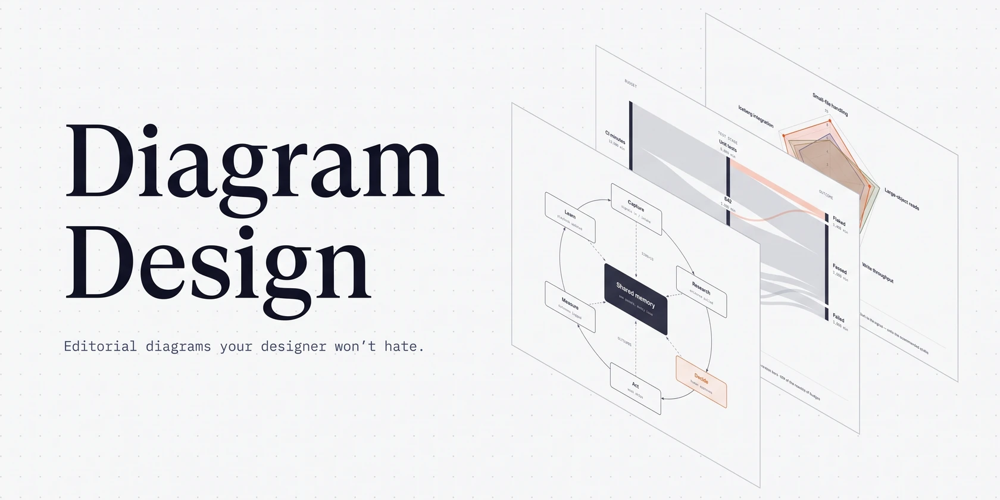
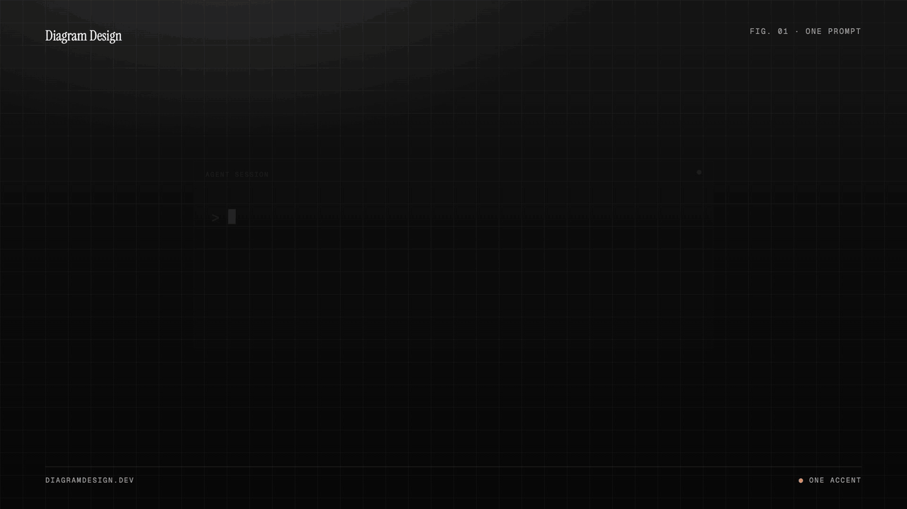

<div align="center">

<h1>
  <picture>
    <source media="(prefers-color-scheme: dark)" srcset="docs/hero/hero-dark.webp">
    
  </picture>
</h1>

**An agent skill that draws diagrams as one self-contained HTML + SVG file, in your brand.<br>45 diagram types. No shadows. No Mermaid slop.**

**[Repository](https://github.com/AndrewGodlewsky/Diagram-design2) · [Gallery files](skills/diagram-design/assets/index.html) · [Changelog](CHANGELOG.md)**

[Install](#install) · [What it makes](#what-it-makes) · [Quickstart](#quickstart) · [Match your brand](#onboarding-make-it-look-like-your-brand) · [Import](#import-from-drawio-mermaid-or-excalidraw) · [Export](#export-to-svg) · [Contributing](#contributing)

Static HTML/SVG · Python standard library · Local fonts · [MIT license](LICENSE)

<br><br>

<picture>
  <source media="(prefers-color-scheme: dark)" srcset="docs/hero/demo.gif">
  <source media="(prefers-color-scheme: light)" srcset="docs/hero/demo-light.gif">
  
</picture>

</div>

<br>

Ask your agent in plain words:

- *"Make me an architecture diagram of my app: frontend, backend, database, Redis cache."*
- *"I need a quadrant showing Q2 projects by impact vs effort."*
- *"Give me a sequence of a bearer call with token refresh on 401."*
- *"Use the brand tokens in `./design/tokens.css` for this diagram."*

The agent picks the type, states its plan, and writes one `.html` file you can open by double-clicking.

---

## Install

For a restricted environment, copy the complete `skills/diagram-design/` directory from a reviewed local checkout into your host's skill directory, such as `.agents/skills/diagram-design` or `.github/skills/diagram-design` for a project. No package manager or download is required for this copy. Keep updates manual so you can review a replacement before using it.

The marketplace commands below are optional network-based installation/update methods. Once installed, the skill's Python tools and generated diagrams require no network access. Your agent provider may still process prompts remotely; configure the host separately if the entire environment must be offline.

Works with any host that reads Agent Skills, including Cursor, Claude Code, Codex, Qoder, GitHub Copilot, Gemini CLI, Cline, Windsurf and Amp:

```bash
npx skills add AndrewGodlewsky/Diagram-design2
```

In Claude Code, the plugin marketplace gets you updates and the slash commands:

```text
/plugin marketplace add AndrewGodlewsky/Diagram-design2
/plugin install diagram-design@diagram-design
```

This repository is maintained by [AndrewGodlewsky](https://github.com/AndrewGodlewsky), based on [Cathryn Lavery's Diagram Design](https://github.com/cathrynlavery/diagram-design). Install commands here track `AndrewGodlewsky/Diagram-design2`; the plugin and skill retain the name `diagram-design`. [PRIVACY.md](PRIVACY.md) explains local processing and the separate role of your agent provider.

**Existing installations:** a marketplace registration remembers its Git source. In each host, inspect the registered `diagram-design` marketplace and switch an upstream registration to this repository using that host's uninstall/remove/add/install flow. The [Copilot CLI section](#github-copilot-migration) gives the exact commands. Reinstall standalone skills from this repository as well; an update of an upstream copy does not switch repositories. Changes in this checkout become available to remote installs after they reach this repository's default branch. External directory listings and organization mirrors must be updated separately by their owners.

<details>
<summary><b>Claude Code</b>: optional auto-update for connected environments</summary>

For a connected environment where automatic updates are wanted, run `/plugin`, open **Marketplaces**, select **diagram-design**, and choose **Enable auto-update**. This permits background network updates. Leave it disabled in restricted environments and use a reviewed local copy instead. Run `/reload-plugins` after an intentional update, or start a new session.

</details>

<details>
<summary><b>Cursor</b>, Cline, Gemini CLI, Windsurf, Amp, Zed, Warp, Roo, Kilo and other Agent Skills hosts</summary>

The cross-agent [`skills` CLI](https://skills.sh) resolves this repository, detects `skills/diagram-design/SKILL.md`, and installs the whole skill (`references/`, `assets/`, `scripts/`) into every host root you select, including Cursor's:

```bash
npx skills add AndrewGodlewsky/Diagram-design2
```

When the selected roots resolve to more than one skills directory, the CLI asks for an installation method and recommends **Symlink**: one canonical copy, linked into each root, so a later update reaches all of them at once. Pass `--copy` for independent copies per host instead. A selection that resolves to a single directory is copied, because the distinction is immaterial there. Where symlinks are unavailable (Windows without Developer Mode) the CLI falls back to copies and reports which roots it copied.

This is a standalone install, separate from the marketplaces below: it does not follow marketplace updates automatically. Pull merged updates with `npx skills update diagram-design`. It also installs the Agent Skill only, so the `/export-diagram`, `/import-mermaid`, `/profile`, and `/doctor` command surfaces stay with the native packages. On a host that has one of the marketplaces below, prefer the marketplace.

> **One-time migration:** an existing standalone `npx skills add` copy will not start following the Codex marketplace automatically. Remove that standalone copy, then use the Codex marketplace commands. Likewise, uninstall a personal Cowork copy and reinstall Diagram Design from your organization's marketplace. Future marketplace version bumps then flow through each client's native update path.

</details>

<details>
<summary><b>Codex</b></summary>

```bash
codex plugin marketplace add AndrewGodlewsky/Diagram-design2
codex plugin add diagram-design@diagram-design
```

Codex refreshes configured Git marketplaces at startup. To fetch immediately, run `codex plugin marketplace upgrade diagram-design` and start a new session.

</details>

<details>
<summary><b>Qoder</b></summary>

Clone the repository, validate the native plugin, and install it locally:

```bash
git clone https://github.com/AndrewGodlewsky/Diagram-design2.git diagram-design
qoder plugins validate ./diagram-design
qoder plugins install ./diagram-design
qoder plugins list
```

Qoder loads the canonical `skills/diagram-design/` tree and the shared command
definitions directly; no Qoder-specific copy is maintained. For Qoder IDE,
build a bounded ZIP from the tracked plugin surfaces and import it through
**Extensions → Plugins → Add Plugins → Upload Plugin**:

```bash
git -C diagram-design archive --format=zip \
  --output=../diagram-design-qoder.zip HEAD \
  .qoder-plugin commands skills LICENSE
```

Start a new task after installing or updating the plugin.

</details>

<a id="github-copilot-migration"></a>
<details>
<summary><b>GitHub Copilot CLI</b></summary>

```bash
copilot plugin marketplace add AndrewGodlewsky/Diagram-design2
copilot plugin install diagram-design@diagram-design
```

Copilot reads the shared `.claude-plugin/marketplace.json` and `.claude-plugin/plugin.json`; a separate Copilot manifest is not required. The marketplace's `source: "./"` loads this repository's plugin root and shared `skills/` tree. See [GitHub's plugin reference](https://docs.github.com/en/copilot/reference/copilot-cli-reference/cli-plugin-reference#file-locations).

Confirm discovery with `copilot plugin list` and `copilot skill list` (or `/skills` in an interactive session), then ask for a diagram in natural language. To fetch a merged update, run `copilot plugin marketplace update diagram-design`, then `copilot plugin update diagram-design@diagram-design`, and start a new session.

**Migrating an existing upstream install:** both repositories use the marketplace name `diagram-design`. Updating the old registration continues to fetch its old repository; editing this checkout does not change a client's saved source. First run `copilot plugin marketplace list` to inspect the registered source. If it points to `cathrynlavery/diagram-design`, switch it once:

```bash
copilot plugin uninstall diagram-design@diagram-design
copilot plugin marketplace remove diagram-design
copilot plugin marketplace add AndrewGodlewsky/Diagram-design2
copilot plugin install diagram-design@diagram-design
copilot plugin marketplace list
copilot plugin list
```

Verify that the marketplace now points to `AndrewGodlewsky/Diagram-design2`, then start a new session. If the plugin is already absent, skip the uninstall command. These steps use GitHub's documented [install and remove commands](https://docs.github.com/en/copilot/how-tos/copilot-cli/customize-copilot/plugins-finding-installing). For Copilot in an IDE, use its plugin management UI to switch the marketplace source, or use the Agent Skills install above.

</details>

<details>
<summary><b>Factory Droid</b></summary>

```bash
droid plugin marketplace add https://github.com/AndrewGodlewsky/Diagram-design2
droid plugin install diagram-design@diagram-design --scope user
```

Droid tracks Git plugins by commit rather than the manifest's display version. To fetch a merged update, run `droid plugin marketplace update diagram-design`, then `droid plugin update diagram-design@diagram-design --scope user`, and start a new session.

</details>

<details>
<summary><b>Claude Cowork</b> (organization marketplace)</summary>

Organization GitHub marketplaces currently require a private or internal repository, so first mirror this public repository into one owned by your organization. In **Organization settings → Plugins**, choose **Add plugin → GitHub**, connect that mirror, and enable **Sync automatically** from the marketplace menu. Automatic sync runs when a pull request containing a plugin version bump is merged to the mirror's default branch; direct pushes do not trigger the webhook. Install Diagram Design from the resulting organization marketplace.

</details>

<details>
<summary><b>Pi</b></summary>

```bash
pi install https://github.com/AndrewGodlewsky/Diagram-design2
```

Run `/reload` in an open Pi session. Pi makes the skill available for matching diagram requests; use `/skill:diagram-design` to invoke it explicitly. Pi also loads the `/export-diagram`, `/import-mermaid`, `/import-excalidraw`, `/profile`, and `/doctor` prompt templates. The unpinned Git install is intentional: Pi has no automatic package refresh, so run `pi update --extensions` to pull merged updates.

</details>

<details>
<summary><b>Kiro</b></summary>

Import the Agent Skill from the repository subdirectory URL:

```text
https://github.com/AndrewGodlewsky/Diagram-design2/tree/main/skills/diagram-design
```

Kiro copies imported skills into `.kiro/skills/` for a workspace or `~/.kiro/skills/` globally, so re-import the URL to pick up updates. Custom agents that declare resources should include `skill://diagram-design/**/SKILL.md`.

</details>

<details>
<summary><b>OpenCode</b></summary>

Copy or symlink `skills/diagram-design/` to `.opencode/skills/diagram-design` in a project or `~/.config/opencode/skills/diagram-design` globally. OpenCode has no Diagram Design marketplace package; copied installs update only when you replace the directory from a newer checkout.

</details>

<details>
<summary><b>Editable install</b> (customize the style guide in a clone)</summary>

Saved profiles in `~/.diagram-design/profiles/` survive package updates. Use profiles or project-local token files for branding; the skill does not modify its installed guide. For development, use a local checkout:

```bash
git clone git@github.com:AndrewGodlewsky/Diagram-design2.git ~/code/diagram-design

# Pi: register the checkout as a local package
pi install ~/code/diagram-design

# Claude Code: symlink the inner skill
ln -s ~/code/diagram-design/skills/diagram-design ~/.claude/skills/diagram-design

# Other Agent Skills hosts: create only the roots you use
mkdir -p ~/.agents/skills ~/.cursor/skills ~/.cline/skills ~/.kiro/skills ~/.config/opencode/skills ~/.copilot/skills
ln -s ~/code/diagram-design/skills/diagram-design ~/.agents/skills/diagram-design
ln -s ~/code/diagram-design/skills/diagram-design ~/.cursor/skills/diagram-design
ln -s ~/code/diagram-design/skills/diagram-design ~/.cline/skills/diagram-design
ln -s ~/code/diagram-design/skills/diagram-design ~/.kiro/skills/diagram-design
ln -s ~/code/diagram-design/skills/diagram-design ~/.config/opencode/skills/diagram-design
ln -s ~/code/diagram-design/skills/diagram-design ~/.copilot/skills/diagram-design
```

The shared skill lives at `skills/diagram-design/`. Pi discovers it through the repo's standard `skills/` package directory; Claude Code, GitHub Copilot, Codex, Factory Droid, Cursor, and other Agent Skills-compatible tools use the same files.

</details>

---

## How it compares

| | Mermaid / PlantUML | draw.io / Excalidraw | Diagram Design |
|---|---|---|---|
| You make it by | Writing text | Dragging shapes by hand | Describing it to your agent |
| Layout | Automatic | Manual | Placed by the agent on a 4px grid, with CI checks for overlaps and clipping |
| Look | The renderer's theme | Whatever you draw | One opinionated editorial style, matched to your brand |
| Output | Text that renders on GitHub | An editable `.drawio` or `.excalidraw` file | One HTML file with inline SVG, exportable to standalone SVG |
| Change it later | Edit the text | Edit the canvas | Ask the agent again, or edit the SVG |
| Existing diagrams | | | Redraws Mermaid, draw.io and Excalidraw files |

The downsides are real. Output quality depends on the model you run it with, and the same prompt can lay out differently twice. The result is not an editable source format: there is no text to diff in a pull request and no canvas to drag a box on. For docs that live in Git and change every sprint, Mermaid is still the better fit. Diagram Design is for the diagram you are going to publish.

---

## Why I built it

I wanted diagrams I actually liked for my blog posts on [littlemight.com](https://littlemight.com). Every time I needed one, whether an architecture sketch, a flowchart, or a pyramid of what matters most, I'd ask Claude and get back a generic rounded-box thing that looked nothing like the rest of the site. I'd either fight with Figma for 30 minutes or skip the diagram.

The model already understood the content. What it was missing was taste, so I wrote the taste down: one accent color for the one or two things that matter, 1px hairlines, no shadows, every coordinate on a 4px grid.

> *The highest-quality move is usually deletion.* Every node earns its place. The accent color is reserved for the 1 or 2 things the reader should look at first. Target density: 4/10.

---

## What it makes

45 diagram types, each in three static variants: minimal light, minimal dark, and full-editorial. Open any of them directly in a browser. There is no build step, JavaScript, font download, or external resource dependency. The authoring tools use Python 3.10+ standard library only.

<table>
<tr>
  <td align="center" width="33%"><a href="docs/screenshots/architecture.png"></a><br><b>Architecture</b><br><sub>Components + connections</sub></td>
  <td align="center" width="33%"><a href="docs/screenshots/it-state.png"></a><br><b>IT current-state</b><br><sub>Legacy landscape + modernization</sub></td>
  <td align="center" width="33%"><a href="docs/screenshots/flowchart.png"></a><br><b>Flowchart</b><br><sub>Decision logic</sub></td>
</tr>
<tr>
  <td align="center"><a href="docs/screenshots/sequence.png"></a><br><b>Sequence</b><br><sub>Messages over time</sub></td>
  <td align="center"><a href="docs/screenshots/state.png"></a><br><b>State machine</b><br><sub>States + transitions</sub></td>
  <td align="center"><a href="docs/screenshots/er.png"></a><br><b>ER / data model</b><br><sub>Entities + fields</sub></td>
</tr>
<tr>
  <td align="center"><a href="docs/screenshots/timeline.png"></a><br><b>Timeline</b><br><sub>Events on an axis</sub></td>
  <td align="center"><a href="docs/screenshots/swimlane.png"></a><br><b>Swimlane</b><br><sub>Cross-functional flow</sub></td>
  <td align="center"><a href="docs/screenshots/quadrant.png"></a><br><b>Quadrant</b><br><sub>Two-axis positioning</sub></td>
</tr>
<tr>
  <td align="center"><a href="docs/screenshots/radar.png"></a><br><b>Radar / spider</b><br><sub>Multi-axis comparison</sub></td>
  <td align="center"><a href="docs/screenshots/loop.png"></a><br><b>Loop / flywheel</b><br><sub>Reinforcing cycle + shared hub</sub></td>
  <td align="center"><a href="docs/screenshots/nested.png"></a><br><b>Nested</b><br><sub>Hierarchy by containment</sub></td>
</tr>
<tr>
  <td align="center"><a href="docs/screenshots/tree.png"></a><br><b>Tree</b><br><sub>Parent → children</sub></td>
  <td align="center"><a href="docs/screenshots/org-chart.png"></a><br><b>Org chart</b><br><sub>Ownership + routing</sub></td>
  <td align="center"><a href="docs/screenshots/layers.png"></a><br><b>Layer stack</b><br><sub>Stacked abstractions</sub></td>
</tr>
<tr>
  <td align="center"><a href="docs/screenshots/venn.png"></a><br><b>Venn</b><br><sub>Set overlap</sub></td>
  <td align="center"><a href="docs/screenshots/pyramid.png"></a><br><b>Pyramid / funnel</b><br><sub>Ranked hierarchy or drop-off</sub></td>
  <td align="center"><a href="docs/screenshots/bar.png"></a><br><b>Bar chart</b><br><sub>Categorical comparison</sub></td>
</tr>
<tr>
  <td align="center"><a href="docs/screenshots/treemap.png"></a><br><b>Treemap</b><br><sub>Part-of-whole by area</sub></td>
  <td align="center"><a href="docs/screenshots/line.png"></a><br><b>Line chart</b><br><sub>Trends over time</sub></td>
  <td align="center"><a href="docs/screenshots/gantt.png"></a><br><b>Gantt</b><br><sub>Tasks + phases on a timeline</sub></td>
</tr>
<tr>
  <td align="center"><a href="docs/screenshots/scatter.png"></a><br><b>Scatter plot</b><br><sub>Distribution + correlation</sub></td>
  <td align="center"><a href="docs/screenshots/high-level.png"></a><br><b>High-Level</b><br><sub>End-to-end stack on a cluster</sub></td>
  <td align="center"><a href="docs/screenshots/process.png"></a><br><b>Process</b><br><sub>Multi-actor sequential workflow</sub></td>
</tr>
<tr>
  <td align="center"><a href="docs/screenshots/medallion.png"></a><br><b>Medallion</b><br><sub>Multi-tier data storage</sub></td>
  <td align="center"><a href="docs/screenshots/data-flow.png"></a><br><b>Data flow</b><br><sub>Role-scoped pipeline steps</sub></td>
  <td align="center"><a href="docs/screenshots/dp-integration.png"></a><br><b>DP integration</b><br><sub>Sources → core → consumers</sub></td>
</tr>
<tr>
  <td align="center"><a href="docs/screenshots/dp-security-matrix.png"></a><br><b>DP security matrix</b><br><sub>Per-role access permissions</sub></td>
  <td align="center"><a href="docs/screenshots/sankey.png"></a><br><b>Sankey</b><br><sub>Quantities that split + merge</sub></td>
  <td align="center"><a href="docs/screenshots/fishbone.png"></a><br><b>Fishbone</b><br><sub>Grouped causes → one effect</sub></td>
</tr>
<tr>
  <td align="center"><a href="docs/screenshots/wardley.png"></a><br><b>Wardley map</b><br><sub>Value chain × evolution</sub></td>
  <td align="center"><a href="docs/screenshots/kanban.png"></a><br><b>Kanban</b><br><sub>Work in progress by state</sub></td>
  <td align="center"><a href="docs/screenshots/journey.png"></a><br><b>User journey</b><br><sub>Stages, actions + sentiment</sub></td>
</tr>
<tr>
  <td align="center"><a href="docs/screenshots/deployment.png"></a><br><b>Deployment</b><br><sub>Zones, hosts + artifacts</sub></td>
  <td align="center"><a href="docs/screenshots/dependency.png"></a><br><b>Dependency graph</b><br><sub>Fan-in, ranks + cycles</sub></td>
  <td align="center"><a href="docs/screenshots/uml-class.png"></a><br><b>UML class</b><br><sub>Classes, operations + typed relations</sub></td>
</tr>
<tr>
  <td align="center"><a href="docs/screenshots/story-map.png"></a><br><b>Story map</b><br><sub>Backbone × release slices</sub></td>
  <td align="center"><a href="docs/screenshots/db-schema.png"></a><br><b>Database schema</b><br><sub>Physical tables + column FKs</sub></td>
  <td align="center"><a href="docs/screenshots/polar.png"></a><br><b>Polar chart</b><br><sub>Cyclic magnitude · linear radius</sub></td>
</tr>
<tr>
  <td align="center" width="33%"><a href="docs/screenshots/waterfall.png"></a><br><b>Waterfall</b><br><sub>Running total + signed bridges</sub></td>
  <td align="center" width="33%"><a href="docs/screenshots/architecture-delta.png"></a><br><b>Architecture delta</b><br><sub>Before · Changes · After topology</sub></td>
  <td align="center" width="33%"><a href="docs/screenshots/exploded.png"></a><br><b>Exploded axonometric</b><br><sub>Parts pulled apart on one axis</sub></td>
</tr>
<tr>
  <td align="center" width="33%"><a href="docs/screenshots/axonometric-plan.png"></a><br><b>Axonometric plan</b><br><sub>Rooms and buildings on one plate</sub></td>
  <td align="center" width="33%"><a href="docs/screenshots/heatmap.png"></a><br><b>Heatmap</b><br><sub>Value per row × column cell</sub></td>
  <td align="center" width="33%"><a href="docs/screenshots/service-blueprint.png"></a><br><b>Service blueprint</b><br><sub>Frontstage and backstage on a shared stage grid</sub></td>
</tr>
</table>

Several types have named variants that share their reference: Line covers slopegraph, ridgeline, streamgraph and bump; Scatter covers bubble, beeswarm and box plot; Treemap covers marimekko.

Architecture can nest administrative bands and traffic boxes in one snapshot when the hierarchy itself is the claim: dashed rx=4 bands for billing and permissions, solid rx=8 boxes for networks, and managed services outside every subnet. See the [containment example](skills/diagram-design/assets/example-architecture-containment.html) and [type-architecture.md](skills/diagram-design/references/type-architecture.md).

Architecture delta compares synchronized topologies through a Before · Changes · After ledger of added, removed, changed, moved, and rewired objects. See its [reference](skills/diagram-design/references/type-architecture-delta.md) and [order-fulfilment example](skills/diagram-design/assets/example-architecture-delta.html). Attribute-only comparisons remain tables; a single snapshot uses Architecture.

Exploded axonometric draws one object in 2:1 dimetric projection with its parts lifted apart at equal gaps: a [phone teardown](skills/diagram-design/assets/example-exploded-phone.html), an [unboxing](skills/diagram-design/assets/example-exploded-unboxing.html), an [app stack](skills/diagram-design/assets/example-exploded.html), an [AI agent stack](skills/diagram-design/assets/example-exploded-ai-stack.html), or a [mechanical keyboard](skills/diagram-design/assets/example-exploded-keyboard.html). Every coordinate comes from one projection function. See its [reference](skills/diagram-design/references/type-exploded.md).

Axonometric plan uses the same projection for one floor or one site: walls cut at desk height so every room reads from a single view, or buildings on a campus tagged by build phase. See the [office floor](skills/diagram-design/assets/example-axonometric-plan.html), the [campus](skills/diagram-design/assets/example-axonometric-plan-campus.html), the [coffee shop](skills/diagram-design/assets/example-axonometric-plan-coffee-shop.html), the [fulfillment floor](skills/diagram-design/assets/example-axonometric-plan-warehouse.html), and the [reference](skills/diagram-design/references/type-axonometric-plan.md).

**Browse the gallery:** open [`skills/diagram-design/assets/index.html`](skills/diagram-design/assets/index.html) locally to follow ordinary links to each light, dark, or full-editorial example. To publish it, enable GitHub Pages with **GitHub Actions** as the source in this repository's settings, then run the existing **Deploy gallery to GitHub Pages** workflow. Its target is [andrewgodlewsky.github.io/Diagram-design2](https://andrewgodlewsky.github.io/Diagram-design2/); this repository has no Pages deployment yet. Each type has one number, 01 to 45; its variants and worked examples carry the same number with a letter. The catalog is static HTML with no JavaScript, frames, or automatic resource loads.

---

## Onboarding: make it look like *your* brand

Use the default jet-black and tangerine palette, or supply a local CSS file, a design-token folder, a style guide, or pasted values. The agent reads only the paths you supply, maps literal values to semantic color and typography roles, and records their provenance. It does not visit websites, run scripts from your files, or follow font URLs.

For example: `Use ./design/tokens.css to style this diagram, then save the profile as acme.` The effective guide stays in the session or a user-selected project file. The installed package remains unchanged.

Text tokens target 4.5:1 contrast and essential marks 3:1 on the actual background. If a supplied token fails, the agent proposes an accessible adjustment and explains it. SVG templates include `role="img"`, resolving `aria-labelledby`, and first-child title/description elements with per-diagram IDs.

Fonts always resolve locally. Optional installed Instrument Serif, Geist, and Geist Mono lead generic serif, sans, and monospace fallbacks. No font files are bundled or downloaded. Font metrics differ across computers; structural checks do not establish pixel-identical rendering. See [Font source](skills/diagram-design/references/style-guide.md#font-source).

For multiple clients, save named profiles outside the package at `~/.diagram-design/profiles/<slug>.md`. An optional project `.diagram-design` marker containing `profile: <slug>` selects one directly. `default` always selects the shipped guide. Use `/diagram-design:profile`, `/profile`, or natural language to manage profiles. See [onboarding.md](skills/diagram-design/references/onboarding.md) and [profiles.md](skills/diagram-design/references/profiles.md).

---

## Quickstart

Browse the [local gallery](skills/diagram-design/assets/index.html) for examples, or start directly from a request. Viewing is optional; authoring and validation do not launch a browser.

Then ask your agent for a diagram, like the prompts at the top of this page. A sequence with token refresh uses the ALT combined-fragment grammar in `type-sequence.md`; see [`example-sequence-oauth.html`](skills/diagram-design/assets/example-sequence-oauth.html).

Operator recipes for editable installs, first diagrams, brand setup, import, export, validation, Windows junctions, and reusable prompts live in [`docs/cookbook.md`](docs/cookbook.md).

You can also start from a template directly:

```bash
cp skills/diagram-design/assets/template.html my-diagram.html        # minimal light
cp skills/diagram-design/assets/template-full.html my-diagram.html   # editorial with summary cards
```

### Semantic patterns

[Semantic patterns](skills/diagram-design/references/semantic-patterns.md) explain behavior such as queue bottlenecks, policy decisions, lifecycle phases, and traceable block decomposition. Select a pattern when behavior carries the meaning, then a visual type for its layout. Every state and outcome is visible in a single static composition.

---

## Import from draw.io, Mermaid, or Excalidraw

Already have diagrams in draw.io / diagrams.net, Mermaid, or Excalidraw? Point the skill at the source and it **redraws** them: same content, this design system, at whatever size the destination needs.

[](docs/screenshots/import-drawio.png)

*A 12-node draw.io file redrawn at `balanced` detail for a blog post. The source's six pastel fills became one accent; its hand-dragged coordinates became a 4px grid.*

```
/diagram-design:import-drawio platform.drawio
/diagram-design:import-drawio platform.drawio --size=slide-16x9 --detail=simplified --audience=executive
/diagram-design:import-drawio platform.drawio --detail=faithful --format=png --page=all
/diagram-design:import-mermaid README.md --diagram=all
/diagram-design:import-mermaid architecture.mmd --size=slide-16x9 --detail=simplified
/diagram-design:import-excalidraw whiteboard.excalidraw --size=slide-16x9 --detail=simplified
```

Or just ask: *"redraw this drawio file for my deck"*, *"make this Mermaid block editorial"*, *"make this whiteboard sketch presentable"*, or *"この Mermaid をスライド用にきれいにして"*.

Reads the common containers draw.io writes (`.drawio`, `.drawio.xml`, `.drawio.png` with an embedded diagram, and `.drawio.svg`), including compressed payloads that look like base64 garbage in an editor.
For Mermaid, it accepts `.mmd`, `.mermaid`, and one or more fenced `mermaid` blocks in Markdown. UTF-8 files may include a byte-order mark.
For Excalidraw, it accepts `.excalidraw` and `.excalidraw.json` scene files (not `.excalidraw.png`/`.excalidraw.svg` exports). It parses text only: no rendering, JavaScript, browser, network, or followed click targets.

### The four dials

The point isn't conversion, it's **fitting the output to where it's going**. Same source file, three different diagrams:

| Dial | Options | What it changes |
|---|---|---|
| **Format** | `html` · `svg` | The deliverable: SVG for vector hand-off, HTML for the complete page. |
| **Size** | `doc-inline` · `doc-wide` · `slide-16x9` · `slide-4x3` · `social-og` · `social-square` · `print-a4-landscape` · `print-a3-landscape` · `print-letter-landscape` · `fit` | The `viewBox` **and the type ramp**: a projected slide gets 16px node names, not 12px. |
| **Detail** | `faithful` (≤24 nodes, zoned) · `balanced` (≤12) · `simplified` (≤7) | How much of the source survives, via a fixed degrade ladder: decorations, then duplicates, then leaf clusters, then infrastructure. |
| **Audience** | `engineer` · `mixed` · `executive` | The *wording*, not the count. `Auth Service / JWT · RS256 · :8443` → `Auth Service / token check` → `Sign-in`. |

Every import ends with a **fidelity ledger** listing what got merged, collapsed, or dropped. You know the source; you'd notice anyway.

```
Detail: balanced · 12 source nodes → 8 drawn
Collapsed: "Token valid?" decision → edge label on Gateway → Auth
Dropped:   1 sticky note ("legacy path, to be retired"), unconnected in source
Kept in full: the request path (Web/Mobile → Gateway → Orders → Postgres)
```

What never carries over: source or renderer coordinates, source palette, source fonts, draw.io's diagonal connector spaghetti, Mermaid's automatic layout, or Excalidraw's hand-drawn geometry. What always does: components, relationships, grouping, and direction. See [`references/import-drawio.md`](skills/diagram-design/references/import-drawio.md), [`references/import-mermaid.md`](skills/diagram-design/references/import-mermaid.md), [`references/import-excalidraw.md`](skills/diagram-design/references/import-excalidraw.md), and [`references/output-spec.md`](skills/diagram-design/references/output-spec.md).

---

## Export to SVG

Ask `Export this diagram as SVG`, or run `/diagram-design:export-diagram path/to/diagram.html` in Claude Code and `/export-diagram path/to/diagram.html` in Pi. The standalone SVG retains diagram CSS and namespaces local definitions. Editorial headers and cards remain in the HTML source.

The packaged helper uses Python's standard library:

```text
python skills/diagram-design/scripts/self_check.py path/to/diagram.html
python skills/diagram-design/scripts/export_svg.py path/to/diagram.html
```

All exports use installed fonts and generic fallbacks. Unsafe or active content is refused before successful output. PNG rendering, animation, remote resources, and browser launch are outside this skill's scope. See [export.md](skills/diagram-design/references/export.md).

For [traceable block decomposition](skills/diagram-design/references/semantic-patterns.md), `--registry` emits only the `.registry.json` metadata sidecar. Combine it with `--svg-only` for both. See [export-registry.md](skills/diagram-design/references/export-registry.md).

---

## Architecture

Progressive disclosure. `SKILL.md` routes behavior first when needed, then layout. Semantic and type references load only when relevant.

```
diagram-design/
├── .agents/plugins/marketplace.json  # Codex marketplace catalog
├── .claude-plugin/                   # Claude marketplace + plugin manifest
├── .codex-plugin/                    # Codex plugin manifest
├── .factory-plugin/                  # Factory Droid marketplace + plugin manifest
├── .qoder-plugin/                    # Qoder native plugin manifest
├── commands/
│   ├── export-diagram.md             # plugin export command
│   ├── import-drawio.md              # plugin draw.io import command
│   ├── import-mermaid.md             # plugin Mermaid import command
│   ├── import-excalidraw.md          # plugin Excalidraw import command
│   ├── profile.md                    # plugin client-profile command
│   └── doctor.md                     # plugin environment diagnostics command
├── prompts/
│   ├── export-diagram.md             # Pi `/export-diagram` prompt template
│   ├── import-mermaid.md             # Pi Mermaid import prompt template
│   ├── import-excalidraw.md          # Pi Excalidraw import prompt template
│   ├── profile.md                    # Pi `/profile` prompt template
│   └── doctor.md                     # Pi `/doctor` diagnostics prompt template
├── skills/
│   └── diagram-design/
│       ├── SKILL.md                  # philosophy, selection guide, checklist
│       ├── references/               # loaded only when a type or primitive is chosen
│       │   ├── style-guide.md        # single source of truth for colors + fonts
│       │   ├── semantic-patterns.md  # behavior patterns independent of layout
│       │   ├── onboarding.md         # local files and pasted brand tokens
│       │   ├── profiles.md           # named client profiles + project markers
│       │   ├── doctor.md             # environment diagnostics
│       │   ├── import-drawio.md      # draw.io redraw procedure
│       │   ├── import-mermaid.md     # Mermaid redraw procedure
│       │   ├── import-excalidraw.md  # Excalidraw redraw procedure
│       │   ├── output-spec.md        # format × size × detail level
│       │   ├── export.md             # local SVG export + sizing
│       │   ├── export-registry.md    # block-metadata JSON sidecar export
│       │   ├── primitives-core.md    # exact markup for nodes, arrows, labels
│       │   ├── layout-budget.md      # 4px grid + per-type budgets
│       │   ├── primitive-annotation.md
│       │   ├── primitive-icons.md
│       │   ├── primitive-sketchy.md
│       │   ├── primitive-terminal.md
│       │   ├── type-architecture.md
│       │   ├── type-architecture-delta.md
│       │   ├── type-axonometric-plan.md
│       │   ├── type-bar.md
│       │   ├── type-data-flow.md
│       │   ├── type-db-schema.md
│       │   ├── type-dependency.md
│       │   ├── type-deployment.md
│       │   ├── type-dp-integration.md
│       │   ├── type-dp-security-matrix.md
│       │   ├── type-er.md
│       │   ├── type-exploded.md
│       │   ├── type-fishbone.md
│       │   ├── type-flowchart.md
│       │   ├── type-gantt.md
│       │   ├── type-heatmap.md
│       │   ├── type-high-level.md
│       │   ├── type-it-state.md
│       │   ├── type-journey.md
│       │   ├── type-kanban.md
│       │   ├── type-layers.md
│       │   ├── type-line.md
│       │   ├── type-loop.md
│       │   ├── type-medallion.md
│       │   ├── type-nested.md
│       │   ├── type-org-chart.md
│       │   ├── type-polar.md
│       │   ├── type-process.md
│       │   ├── type-pyramid.md
│       │   ├── type-quadrant.md
│       │   ├── type-radar.md
│       │   ├── type-sankey.md
│       │   ├── type-scatter.md
│       │   ├── type-sequence.md
│       │   ├── type-service-blueprint.md
│       │   ├── type-state.md
│       │   ├── type-story-map.md
│       │   ├── type-swimlane.md
│       │   ├── type-timeline.md
│       │   ├── type-tree.md
│       │   ├── type-treemap.md
│       │   ├── type-uml-class.md
│       │   ├── type-venn.md
│       │   ├── type-wardley.md
│       │   └── type-waterfall.md
│       ├── scripts/
│       │   ├── drawio_extract.py     # draw.io → structured IR
│       │   ├── mermaid_extract.py    # Mermaid → structured IR
│       │   ├── excalidraw_extract.py  # Excalidraw → structured IR
│       │   ├── export_svg.py         # standalone SVG export
│       │   ├── static_safety.py      # shared local/static content validation
│       │   └── self_check.py         # packaged output self-check (runs installed)
│       └── assets/
│           ├── index.html            # static gallery with ordinary links
│           ├── icons.html            # icon library browser
│           ├── template*.html        # scaffolds for new diagrams
│           ├── example-<type>.html   # 3 variants per type
│           ├── example-loop-terminal.html
│           ├── example-quadrant-consultant.html
│           ├── example-import-drawio.html
│           ├── example-import-mermaid.html
│           ├── example-import-excalidraw.html
│           └── example-sequence-oauth*.html
├── scripts/                          # CI gates and build helpers (see CONTRIBUTING.md)
│   ├── lint-skin.py                  # palette, fonts, a11y, single-file safety
│   ├── verify-docs-sync.py           # routing, gallery, README and count sync
│   ├── verify-geometry.py            # label, connector and port geometry
│   └── fixtures/                     # draw.io, Mermaid and Excalidraw test inputs
├── docs/cookbook.md                  # operator recipes for editable installs and common tasks
├── docs/adr/                         # short records of settled design decisions
├── docs/superpowers/                 # design specs and implementation plans (plans/, specs/)
├── docs/hero/                        # README demo GIFs (dark, light) and social preview image
├── docs/screenshots/                 # existing full-resolution gallery previews
├── docs/screenshots/thumbs/          # generated WebP previews the README renders
├── CHANGELOG.md                      # release history
└── CONTRIBUTING.md                   # validation gates and how each one works
```

This keeps the agent's working context tight: routine diagrams load one type reference; behavior-rich diagrams add the routed semantic reference.

### What loads when

At startup, the agent sees only the skill name and description. When a request matches, it loads `SKILL.md`; semantic and type references are pulled in only when relevant.

| You ask for… | Agent loads |
|---|---|
| "Make me a flowchart" | `SKILL.md` + `references/type-flowchart.md` |
| "Build an architecture diagram" | `SKILL.md` + `references/type-architecture.md` |
| "Show nested admin vs traffic scopes" | `SKILL.md` + `references/type-architecture.md` |
| "Show what was added, removed, changed, moved, or rewired in this migration" | `SKILL.md` + `references/type-architecture-delta.md` |
| "Show what's inside this device, exploded" | `SKILL.md` + `references/type-exploded.md` |
| "Draw our office floor plan" | `SKILL.md` + `references/type-axonometric-plan.md` |
| "Compare why these two policy requests differ" | `SKILL.md` + `references/semantic-patterns.md` + `references/type-flowchart.md` |
| "Use the tokens in my local style guide" | `SKILL.md` + `references/onboarding.md` + `references/style-guide.md` |
| "Use my saved Acme client profile" | `SKILL.md` + `references/profiles.md` + `~/.diagram-design/profiles/acme.md` |
| "Add an editorial callout to this diagram" | `SKILL.md` + `references/primitive-annotation.md` |
| "Give me a hand-drawn version" | `SKILL.md` + `references/primitive-sketchy.md` |
| "Give me a terminal / CLI-window version" | `SKILL.md` + `references/primitive-terminal.md` |
| "Redraw this .drawio file for my deck" | `SKILL.md` + `references/import-drawio.md` + `references/output-spec.md` + the chosen type's reference |
| "Redraw this Mermaid block for my deck" | `SKILL.md` + `references/import-mermaid.md` + `references/output-spec.md` + the chosen type's reference |
| "Redraw this Excalidraw sketch for my deck" | `SKILL.md` + `references/import-excalidraw.md` + `references/output-spec.md` + the chosen type's reference |
| Routine static diagram-making (any visual type) | `SKILL.md` + that one type's reference, plus `references/primitives-core.md` or `references/layout-budget.md` only when it needs exact markup or a per-type budget row |

No matter how many types exist, the agent only reads the one you need. Add a new type tomorrow and nothing else changes.

---

## It's working if…

- A routine request ("make me a flowchart") loads `SKILL.md`, exactly one type reference, and at most the two core references (`primitives-core.md`, `layout-budget.md`), and nothing else.
- Before drawing, the agent states the chosen type, pattern, size, and planned cuts, then renders.
- The output is one `.html` file that opens double-clicked, offline, with no network requests.
- Screen readers announce the diagram's title and description; all meaning is present in one static frame.
- `python3 skills/diagram-design/scripts/self_check.py <file>` prints `OK` on the generated file.
- After brand onboarding, new diagrams use the supplied local paper, ink, accent, and font stacks, with their sources recorded.

If any of these fail, that's a bug worth filing.

## The design system (in one paragraph)

One accent color, 1 or 2 focal elements per diagram. Three optional installed font families: Instrument Serif (title + italic callouts), Geist sans (node names), Geist Mono (technical sublabels), each with a generic fallback. 1px hairline borders, no shadows, max border-radius 10px. Every coordinate, width, and gap is divisible by 4. That rule is non-negotiable; it's what keeps the diagrams from feeling AI-generated. Mono is for technical content (ports, URLs, field types), not a blanket "dev" aesthetic. Accent-tinted focal nodes draw the eye to the 1 or 2 things that matter. Full spec in [`SKILL.md`](skills/diagram-design/SKILL.md#5-design-system).

---

## Primitives

- **Annotation callout**: italic Instrument Serif + dashed Bézier leader, for editorial asides that sit in the margins. See [`skills/diagram-design/references/primitive-annotation.md`](skills/diagram-design/references/primitive-annotation.md).
- **Sketchy filter**: SVG turbulence + displacement map for a hand-drawn variant. Good for essays, not for technical docs. See [`skills/diagram-design/references/primitive-sketchy.md`](skills/diagram-design/references/primitive-sketchy.md).
- **Icon set**: 87 monochrome IT/cloud icons (laptop, phone, user, server, database, Docker, Kubernetes, AWS, Azure, GitHub, Postgres…) for richer architecture and sequence diagrams. Stroked icons from [Tabler Icons](https://tabler.io/icons) (MIT); brand silhouettes from [Simple Icons](https://simpleicons.org) (CC0). Each icon uses `currentColor` so it inherits the editorial skin or your onboarded brand. See [`skills/diagram-design/references/primitive-icons.md`](skills/diagram-design/references/primitive-icons.md); browse the [gallery](skills/diagram-design/assets/icons.html). Regenerate with `python scripts/build-icons.py`.

---

## When *not* to use this skill

- **Diagrams that live in Git and change every sprint** → Mermaid. It diffs, and GitHub renders it.
- **Quick unicode diagrams** for tweets or terminal output → wiretext-style skill.
- **Lists of anything** → a table or bullets.
- **Before/after comparisons** → a table.
- **One-shape "diagrams"** (a single box with a label) → just write the sentence.

Before drawing, ask: *would a reader learn more from this than from a well-written paragraph?* If no, don't draw.

---

## Contributing

Contributions are welcome: new diagram types, import grammar support, examples, docs, and tooling. [CONTRIBUTING.md](CONTRIBUTING.md) covers the validation gates (static safety, skin lint, geometry and data-encoding verifiers, docs sync), how each one works, and the CI setup. Every pull request runs them on Linux, Windows, and macOS. See [CODE_OF_CONDUCT.md](CODE_OF_CONDUCT.md) for community standards and [CHANGELOG.md](CHANGELOG.md) for release history.

---

## About

Maintained here by [AndrewGodlewsky](https://github.com/AndrewGodlewsky). Originally created by **Cathryn Lavery** at [LittleMight](https://littlemight.com). The original MIT copyright and license are preserved in [LICENSE](LICENSE).
