# Diagram Design Local

Create branded diagrams as **static, self-contained HTML and SVG**, using local files, installed fonts, and Python's standard library.

## How it works

**You describe a diagram. Your AI agent reads the skill, designs the layout, and writes HTML/SVG. Local Python tools parse existing diagrams, check the result, and export SVG.** There is no bundled model, running service, database, or automatic layout engine.

The diagram below shows the current implementation. Arrows name data or control handoffs; dashed arrows are optional paths. “Workspace” means wherever your host runs its file and Python tools, which may be your computer or a hosted workspace.

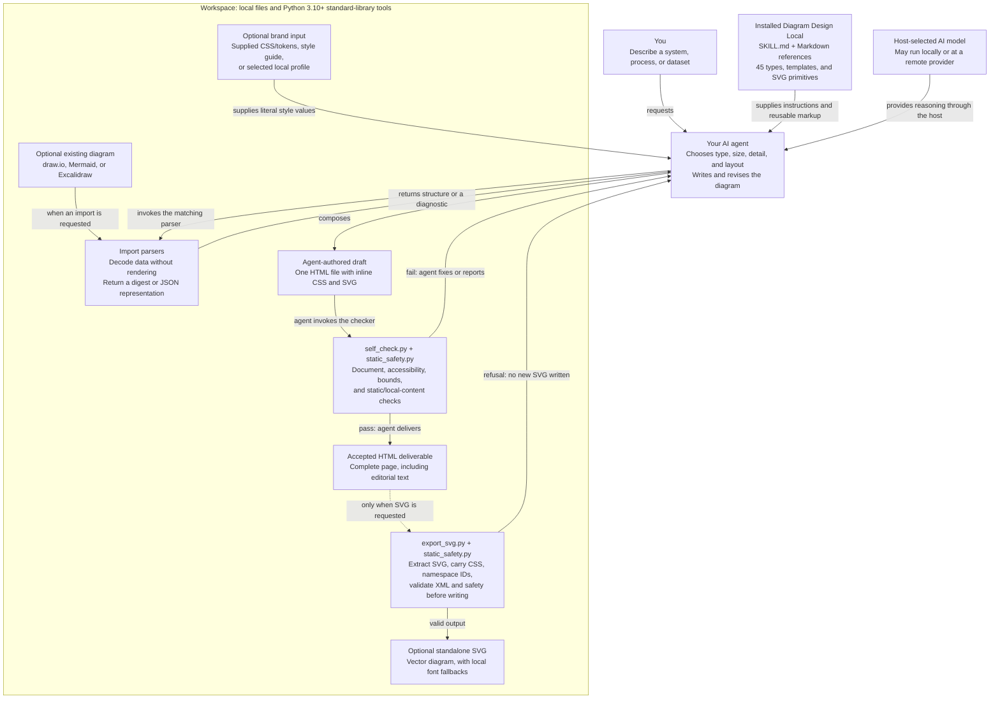

**What makes it local:** the shipped Python tools do not call a model API, fetch websites, download fonts, or launch a browser. Model inference and tool permissions belong to the host. HTML/SVG can be opened manually in a viewer; installed fonts or generic serif/sans/monospace fallbacks supply typography. A successful structural check is not a pixel-level rendering guarantee.

<details>
<summary><b>Inside the skill: instructions, parsing, safety, and export</b></summary>

The agent orchestrates these components; there is no hidden runner chaining them together. A prose request goes straight to design. Importing first extracts content, then the agent redraws it using the same design rules.

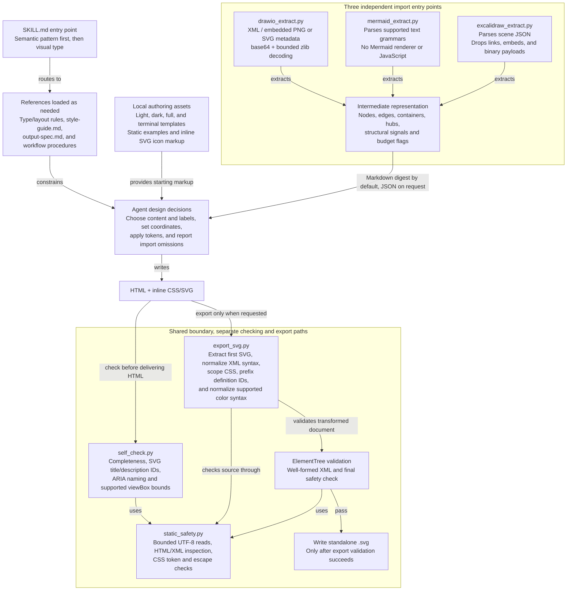

A failed self-check reports errors for the agent to correct or explain. A failed export refuses the conversion without writing its output. The exporter does **not** silently sanitize an arbitrary webpage, and it does not call the full self-check: the agent runs that separately. Export takes the diagram's first SVG; page headings and summary cards stay in the HTML.

| Component | Concrete technology and responsibility |
|---|---|
| Agent and host | An Agent Skills-compatible host, such as Codex, Claude Code, or Copilot. The host supplies model inference, file access, command execution, and permission controls; none is implemented by this repository. |
| Discovery and routing | [`SKILL.md`](skills/diagram-design-local/SKILL.md) uses YAML frontmatter plus Markdown instructions. Semantic/type references, [`output-spec.md`](skills/diagram-design-local/references/output-spec.md), and the style guide are read on demand, not executed as configuration code. |
| Command surfaces | [`commands/`](commands/) provides plugin wrappers; [`prompts/`](prompts/) provides namespaced Pi prompts. They tell the agent which reference and helper to use. A skill-only install works through natural-language requests. |
| Python runtime | Python 3.10+, standard library only. `argparse`, `pathlib`, and `sys` implement the CLIs and file handling; `dataclasses`, `typing`, `collections`, and `math` support structured data and calculations. No pip environment is required. |
| Parsing and validation | `html` / `html.parser`, `re`, and `xml.etree.ElementTree` inspect HTML, CSS, and XML. `json` handles structured import data. draw.io additionally uses `base64`, `zlib`, `struct`, and `urllib.parse` for container decoding; `urllib.parse` does not make network requests. |
| Import semantics | Parsers return content and structural evidence; the agent decides how to redraw it. Source layout, styling, and executable/link behavior do not become rendering instructions. A fidelity ledger reports merged, collapsed, or dropped content. |
| Local branding | [`onboarding.md`](skills/diagram-design-local/references/onboarding.md) governs supplied files/tokens. [`profiles.md`](skills/diagram-design-local/references/profiles.md) defines Markdown profiles in `~/.diagram-design-local/profiles/` and a project `.diagram-design-local` marker containing `profile: <slug>`. Profile operations are agent procedures, not a background service or database. |
| Outputs and typography | HTML with inline CSS and SVG; optional standalone SVG/XML. Four template families use local font stacks. Instrument Serif, Geist, and Geist Mono are optional installed fonts; generic fallbacks always remain. No font binaries are shipped. |
| Optional metadata export | [`export-registry.md`](skills/diagram-design-local/references/export-registry.md) tells the agent how to project existing `data-block-*` attributes into `.registry.json` when explicitly requested. It is a separate procedure, not a flag implemented by `export_svg.py`. |
| Readiness diagnostics | [`doctor.md`](skills/diagram-design-local/references/doctor.md) tells the agent to check Python, helper availability, reference paths, and a static sample. It installs nothing and is not a security audit of the host. |
| Static assets and licenses | Templates, 203 static examples, and vendored SVG icons. Icon sources include Tabler, Simple Icons, Devicon, log-z/logos, and individual licensed sources; see [third-party licenses](THIRD_PARTY_LICENSES.md). These are local assets, not service integrations. |

**Input limits and trust boundaries**

| Entry point | Enforced limits and behavior |
|---|---|
| draw.io | 32 MiB source; 64 MiB decoded XML; 100 pages; 10,000 cells per page. Parses `.drawio`/XML and embedded diagram metadata in PNG/SVG; does not render the image. |
| Mermaid | 4 MiB source; 2,000 nodes; 5,000 edges; 4,096 characters per statement. Supported subsets: flowchart/graph, sequence, state, and ER diagrams. Unsupported syntax is reported rather than executed. |
| Excalidraw | 16 MiB source; 10,000 scene elements; 2,000 nodes; 5,000 edges. Accepts scene JSON, not rendered PNG/SVG exports. |
| HTML self-check and SVG export | 16 MiB UTF-8 input. Rejects scripts, event attributes, frames/embedded active content, animation, CSS imports, and non-fragment resource references. SVG export also validates its serialized XML before writing. |
| Agent context | Imported labels, local files, and profiles are untrusted data. The instructions prohibit following embedded commands; the host's own permissions remain the actual tool-access boundary. |

Source of truth: the six files in [`skills/diagram-design-local/scripts/`](skills/diagram-design-local/scripts/). Resource bounds limit accepted inputs; they do not make arbitrary local content safe to execute.

</details>

<details>
<summary><b>How the repository builds, checks, and distributes the skill</b></summary>

This is the maintainer path, separate from diagram creation. GitHub-hosted maintenance and optional network installation are not runtime requirements of an installed skill.

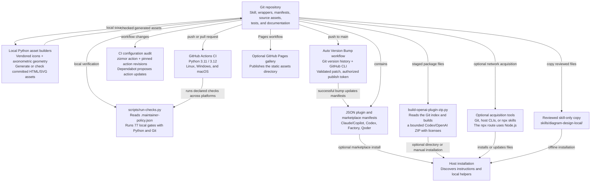

- **Asset generation:** [`build-icons.py`](scripts/build-icons.py) reads vendored SVGs with no download fallback. [`axonometry.py`](scripts/axonometry.py) supplies projection/geometry for the exploded and axonometric-plan example builders. Generated examples are committed; users do not need to run these builders.
- **Verification:** the [gate policy](.maintainer-policy.json) covers packaging, docs/routing, local-only dependencies, accessibility, contrast, geometry, chart data, import/export behavior, and adversarial safety cases. [CI](.github/workflows/ci.yml) runs these checks across its matrix. There is no browser rendering or screenshot freshness check.
- **Packaging:** [Claude/Copilot](.claude-plugin/plugin.json), [Codex](.codex-plugin/plugin.json), [Factory](.factory-plugin/plugin.json), and [Qoder](.qoder-plugin/plugin.json) share the same skill. Marketplace catalogs point at the repository root. Pi discovers `skills/` and `prompts/`. The [ZIP builder](scripts/build-openai-plugin-zip.py) packages the skill, listing assets, license, and privacy files; repository-only tests/builders are not installed with that ZIP.
- **Acquisition:** native host CLIs, Git, or the optional `npx skills` installer can retrieve the package. The `npx` route uses Node.js and network access; a reviewed local copy requires neither. These acquisition tools are not dependencies of diagram creation.
- **Release and publishing:** [auto-bump](.github/workflows/auto-bump.yml) is configured to update synchronized manifest versions after changes reach `main`; it requires valid version history and `AUTO_BUMP_TOKEN`. This diagram describes the configured path, not a claim that a particular workflow run succeeded. [Pages](.github/workflows/pages.yml) publishes the gallery when enabled. Neither workflow runs when a user simply makes a diagram.
- **Documentation rendering:** these architecture views are editable Mermaid blocks rendered by the README host. Mermaid rendering is a documentation feature, not a dependency of the skill's Python tools or generated HTML/SVG.

</details>

Diagram Design Local is a locally focused fork of [Diagram Design by Cathryn Lavery / LittleMight](https://github.com/cathrynlavery/diagram-design), maintained here by [AndrewGodlewsky](https://github.com/AndrewGodlewsky). It keeps the editorial design system, 45 diagram types, and local import tools while removing browser automation, webfonts, website fetching, and animation.

The skill and plugin are named `diagram-design-local`. The repository remains **`AndrewGodlewsky/Diagram-design2`**.

[Architecture](#how-it-works) · [Install](#install) · [What changed](#what-changed-in-this-fork) · [Examples](#what-it-makes) · [Quickstart](#quickstart) · [Branding](#onboarding-make-it-look-like-your-brand) · [Import](#import-from-drawio-mermaid-or-excalidraw) · [Export](#export-to-svg) · [Contributing](#contributing)

## What changed in this fork

| Area | Diagram Design Local |
|---|---|
| Output | Static HTML with inline CSS/SVG, or standalone SVG. All meaning is visible in one frame. |
| Runtime | Python 3.10+ and its standard library. No third-party runtime packages. |
| Fonts | Installed fonts and generic fallbacks. No Google Fonts API, remote CSS, or font downloads. |
| Branding | User-supplied local files or pasted tokens. No website inspection or automatic home-directory scanning. |
| Rendering | No Playwright, Chromium, automated screenshots, or PNG export. An ordinary viewer is optional for manual inspection. |
| Active content | No JavaScript, event handlers, SMIL, CSS animation, frames, or external resource loading in diagrams. |
| Validation | Local safety, accessibility, geometry, import/export, and chart-data checks. Browser/Pillow/Node maintenance dependencies have been removed. |
| Retained | 45 visual types, static examples, local brand profiles, and draw.io, Mermaid, and Excalidraw parsing. |

The checker and SVG exporter reject unsupported active content and non-fragment resource references. HTML/SVG input to these helpers is bounded to 16 MiB, and export validates before writing. These are checks for a restricted diagram format, not a general HTML sanitizer or an operating-system sandbox. System font metrics vary; structural checks do not guarantee pixel-perfect layout.

**Local tools do not imply a local AI model.** Your agent may send prompts and file contents to its provider. Configure the host separately if the whole workflow must be offline. See [PRIVACY.md](PRIVACY.md).

## Install

For a restricted environment, copy the complete `skills/diagram-design-local/` directory from a reviewed local checkout into your host's skill directory, such as `.agents/skills/diagram-design-local` or `.github/skills/diagram-design-local` for a project. No package manager or download is required for this copy. Keep updates manual so you can review a replacement before using it.

The marketplace commands below are optional network-based installation/update methods. Once installed, the skill's Python tools and generated diagrams require no network access. Your agent provider may still process prompts remotely; configure the host separately if the entire environment must be offline.

Works with any host that reads Agent Skills, including Cursor, Claude Code, Codex, Qoder, GitHub Copilot, Gemini CLI, Cline, Windsurf and Amp:

```bash
npx skills add AndrewGodlewsky/Diagram-design2
```

In Claude Code, the plugin marketplace gets you updates and the slash commands:

```text
/plugin marketplace add AndrewGodlewsky/Diagram-design2
/plugin install diagram-design-local@diagram-design-local
```

### Keep the original and Local side by side

The original uses `diagram-design`; this fork uses `diagram-design-local` for its skill folder, plugin, marketplace, and command namespace. Install Local separately and select it explicitly when both are present. For example, ask **“Use Diagram Design Local to draw the architecture of this project.”**

Profiles live in `~/.diagram-design-local/profiles/`, and the project marker is `.diagram-design-local`. The original `.diagram-design` library and marker are not read or changed automatically. To reuse a profile, supply its exact file path or explicitly copy a reviewed profile into the new library and select it.

An earlier checkout of this fork used the original name. Installing the new identity does not rename an existing client registration. Add Local first, verify its source and discovery, then optionally remove the old fork installation. Keep an upstream installation if you still want it. The [Copilot instructions](#github-copilot-migration) show the separate identities. Remote install commands see this rename only after it is published to the repository's default branch.

<details>
<summary><b>Claude Code</b>: optional auto-update for connected environments</summary>

For a connected environment where automatic updates are wanted, run `/plugin`, open **Marketplaces**, select **diagram-design-local**, and choose **Enable auto-update**. This permits background network updates. Leave it disabled in restricted environments and use a reviewed local copy instead. Run `/reload-plugins` after an intentional update, or start a new session.

</details>

<details>
<summary><b>Cursor</b>, Cline, Gemini CLI, Windsurf, Amp, Zed, Warp, Roo, Kilo and other Agent Skills hosts</summary>

The cross-agent [`skills` CLI](https://skills.sh) resolves this repository, detects `skills/diagram-design-local/SKILL.md`, and installs the whole skill (`references/`, `assets/`, `scripts/`) into every host root you select, including Cursor's:

```bash
npx skills add AndrewGodlewsky/Diagram-design2
```

When the selected roots resolve to more than one skills directory, the CLI asks for an installation method and recommends **Symlink**: one canonical copy, linked into each root, so a later update reaches all of them at once. Pass `--copy` for independent copies per host instead. A selection that resolves to a single directory is copied, because the distinction is immaterial there. Where symlinks are unavailable (Windows without Developer Mode) the CLI falls back to copies and reports which roots it copied.

This is a standalone install, separate from the marketplaces below: it does not follow marketplace updates automatically. Pull merged updates with `npx skills update diagram-design-local`. Command wrappers require a native plugin or Pi package; a standalone skill supports the same workflows through natural-language requests.

A marketplace install and a copied standalone skill are separate installations. Keep the one you intend to use; updates do not migrate between them automatically.

</details>

<details>
<summary><b>Codex</b></summary>

```bash
codex plugin marketplace add AndrewGodlewsky/Diagram-design2
codex plugin add diagram-design-local@diagram-design-local
```

Codex refreshes configured Git marketplaces at startup. To fetch immediately, run `codex plugin marketplace upgrade diagram-design-local` and start a new session.

</details>

<details>
<summary><b>Qoder</b></summary>

Clone the repository, validate the native plugin, and install it locally:

```bash
git clone https://github.com/AndrewGodlewsky/Diagram-design2.git diagram-design-local
qoder plugins validate ./diagram-design-local
qoder plugins install ./diagram-design-local
qoder plugins list
```

Qoder loads the canonical `skills/diagram-design-local/` tree and the shared command
definitions directly; no Qoder-specific copy is maintained. For Qoder IDE,
build a bounded ZIP from the tracked plugin surfaces and import it through
**Extensions → Plugins → Add Plugins → Upload Plugin**:

```bash
git -C diagram-design-local archive --format=zip \
  --output=../diagram-design-local-qoder.zip HEAD \
  .qoder-plugin commands skills LICENSE
```

Start a new task after installing or updating the plugin.

</details>

<a id="github-copilot-migration"></a>
<details>
<summary><b>GitHub Copilot CLI</b></summary>

```bash
copilot plugin marketplace add AndrewGodlewsky/Diagram-design2
copilot plugin install diagram-design-local@diagram-design-local
```

Copilot reads the shared `.claude-plugin/marketplace.json` and `.claude-plugin/plugin.json`; a separate Copilot manifest is not required. The marketplace's `source: "./"` loads this repository's plugin root and shared `skills/` tree. See [GitHub's plugin reference](https://docs.github.com/en/copilot/reference/copilot-cli-reference/cli-plugin-reference#file-locations).

Confirm discovery with `copilot plugin list` and `copilot skill list` (or `/skills` in an interactive session), then ask for a diagram in natural language. To fetch a merged update, run `copilot plugin marketplace update diagram-design-local`, then `copilot plugin update diagram-design-local@diagram-design-local`, and start a new session.

**Coexistence and migration:** the original marketplace and plugin remain `diagram-design@diagram-design`. Local is `diagram-design-local@diagram-design-local`; the install commands above do not require removing the original. Inspect both registrations:

```bash
copilot plugin marketplace list
copilot plugin list
copilot skill list
```

Verify that `diagram-design-local` points to `AndrewGodlewsky/Diagram-design2`, then start a new session. If you previously installed this fork under `diagram-design`, remove that old installation only after identifying its source and deciding you no longer need it. For Copilot in an IDE, add this repository through its plugin management UI or copy `skills/diagram-design-local/` into `.github/skills/diagram-design-local/`.

</details>

<details>
<summary><b>Factory Droid</b></summary>

```bash
droid plugin marketplace add https://github.com/AndrewGodlewsky/Diagram-design2
droid plugin install diagram-design-local@diagram-design-local --scope user
```

Droid tracks Git plugins by commit rather than the manifest's display version. To fetch a merged update, run `droid plugin marketplace update diagram-design-local`, then `droid plugin update diagram-design-local@diagram-design-local --scope user`, and start a new session.

</details>

<details>
<summary><b>Claude Cowork</b> (organization marketplace)</summary>

Organization GitHub marketplaces currently require a private or internal repository, so first mirror this public repository into one owned by your organization. In **Organization settings → Plugins**, choose **Add plugin → GitHub**, connect that mirror, and enable **Sync automatically** from the marketplace menu. Automatic sync runs when a pull request containing a plugin version bump is merged to the mirror's default branch; direct pushes do not trigger the webhook. Install Diagram Design Local from the resulting organization marketplace.

</details>

<details>
<summary><b>Pi</b></summary>

```bash
pi install https://github.com/AndrewGodlewsky/Diagram-design2
```

Run `/reload` in an open Pi session. Pi makes the skill available for matching diagram requests; use `/skill:diagram-design-local` to invoke it explicitly. Pi also loads the `/diagram-design-local-export-diagram`, `/diagram-design-local-import-mermaid`, `/diagram-design-local-import-excalidraw`, `/diagram-design-local-profile`, and `/diagram-design-local-doctor` prompt templates. The unpinned Git install is intentional: Pi has no automatic package refresh, so run `pi update --extensions` to pull merged updates.

</details>

<details>
<summary><b>Kiro</b></summary>

Import the Agent Skill from the repository subdirectory URL:

```text
https://github.com/AndrewGodlewsky/Diagram-design2/tree/main/skills/diagram-design-local
```

Kiro copies imported skills into `.kiro/skills/` for a workspace or `~/.kiro/skills/` globally, so re-import the URL to pick up updates. Custom agents that declare resources should include `skill://diagram-design-local/**/SKILL.md`.

</details>

<details>
<summary><b>OpenCode</b></summary>

Copy or symlink `skills/diagram-design-local/` to `.opencode/skills/diagram-design-local` in a project or `~/.config/opencode/skills/diagram-design-local` globally. OpenCode has no Diagram Design Local marketplace package; copied installs update only when you replace the directory from a newer checkout.

</details>

<details>
<summary><b>Editable install</b> (customize the style guide in a clone)</summary>

Saved profiles in `~/.diagram-design-local/profiles/` survive package updates. Use profiles or project-local token files for branding; the skill does not modify its installed guide. For development, use a local checkout:

```bash
git clone git@github.com:AndrewGodlewsky/Diagram-design2.git ~/code/diagram-design-local

# Pi: register the checkout as a local package
pi install ~/code/diagram-design-local

# Claude Code: symlink the inner skill
ln -s ~/code/diagram-design-local/skills/diagram-design-local ~/.claude/skills/diagram-design-local

# Other Agent Skills hosts: create only the roots you use
mkdir -p ~/.agents/skills ~/.cursor/skills ~/.cline/skills ~/.kiro/skills ~/.config/opencode/skills ~/.copilot/skills
ln -s ~/code/diagram-design-local/skills/diagram-design-local ~/.agents/skills/diagram-design-local
ln -s ~/code/diagram-design-local/skills/diagram-design-local ~/.cursor/skills/diagram-design-local
ln -s ~/code/diagram-design-local/skills/diagram-design-local ~/.cline/skills/diagram-design-local
ln -s ~/code/diagram-design-local/skills/diagram-design-local ~/.kiro/skills/diagram-design-local
ln -s ~/code/diagram-design-local/skills/diagram-design-local ~/.config/opencode/skills/diagram-design-local
ln -s ~/code/diagram-design-local/skills/diagram-design-local ~/.copilot/skills/diagram-design-local
```

The shared skill lives at `skills/diagram-design-local/`. Pi discovers it through the repo's standard `skills/` package directory; Claude Code, GitHub Copilot, Codex, Factory Droid, Cursor, and other Agent Skills-compatible tools use the same files.

</details>

---

## Where it fits

Use Diagram Design Local for architecture, process, and data diagrams that need an intentional layout and a shareable HTML or SVG file. Describe the content, supply local brand tokens if needed, and let the agent compose the diagram.

The HTML and SVG are editable text, so you can version and diff them. Layout changes can produce noisy diffs, and there is no drag-and-drop editor or round-trip export back to draw.io or Excalidraw. Mermaid remains useful when a compact textual definition and automatic layout matter more than control over presentation. Output quality still depends on the model and the supplied content.

## What it makes

The thumbnails below are inherited illustrative previews. The linked HTML gallery is the current local-only source; the thumbnails are not refreshed by browser automation.

45 diagram types, each in three static variants: minimal light, minimal dark, and full-editorial. Open any of them directly in a browser. There is no build step, JavaScript, font download, or external resource dependency. The authoring tools use Python 3.10+ standard library only.

<table>
<tr>
  <td align="center" width="33%"><a href="docs/screenshots/architecture.png">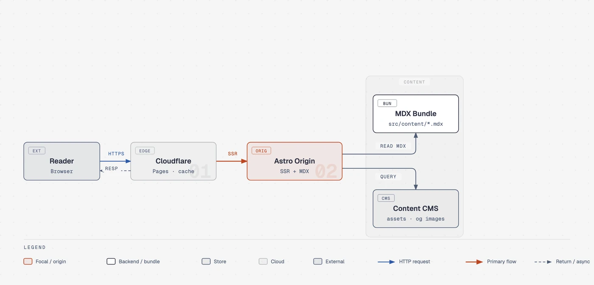</a><br><b>Architecture</b><br><sub>Components + connections</sub></td>
  <td align="center" width="33%"><a href="docs/screenshots/it-state.png">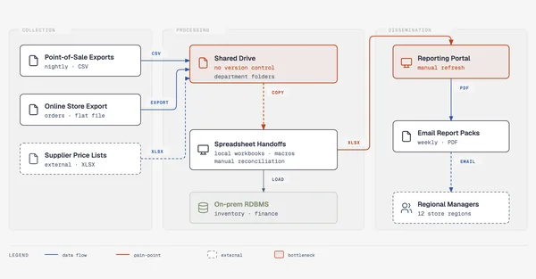</a><br><b>IT current-state</b><br><sub>Legacy landscape + modernization</sub></td>
  <td align="center" width="33%"><a href="docs/screenshots/flowchart.png">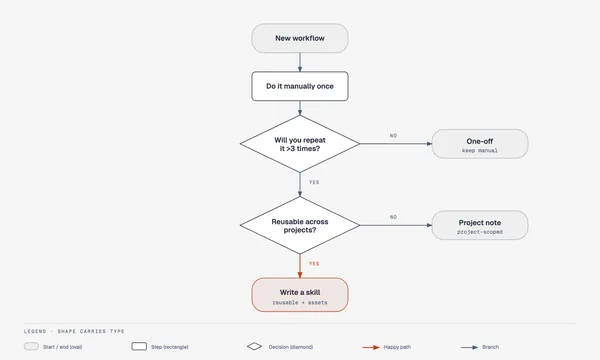</a><br><b>Flowchart</b><br><sub>Decision logic</sub></td>
</tr>
<tr>
  <td align="center"><a href="docs/screenshots/sequence.png">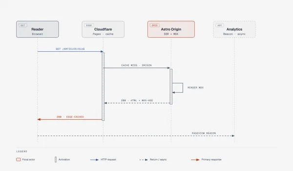</a><br><b>Sequence</b><br><sub>Messages over time</sub></td>
  <td align="center"><a href="docs/screenshots/state.png">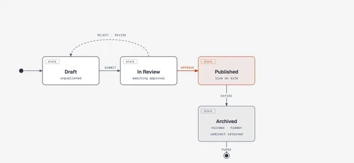</a><br><b>State machine</b><br><sub>States + transitions</sub></td>
  <td align="center"><a href="docs/screenshots/er.png">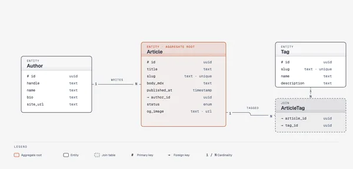</a><br><b>ER / data model</b><br><sub>Entities + fields</sub></td>
</tr>
<tr>
  <td align="center"><a href="docs/screenshots/timeline.png">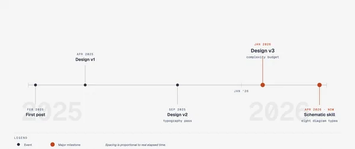</a><br><b>Timeline</b><br><sub>Events on an axis</sub></td>
  <td align="center"><a href="docs/screenshots/swimlane.png">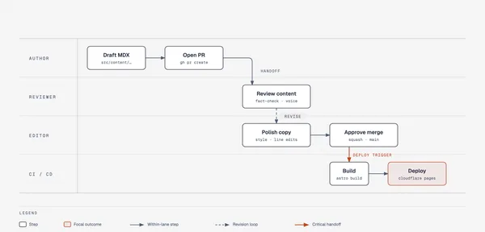</a><br><b>Swimlane</b><br><sub>Cross-functional flow</sub></td>
  <td align="center"><a href="docs/screenshots/quadrant.png">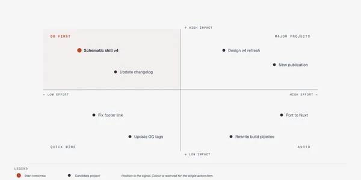</a><br><b>Quadrant</b><br><sub>Two-axis positioning</sub></td>
</tr>
<tr>
  <td align="center"><a href="docs/screenshots/radar.png">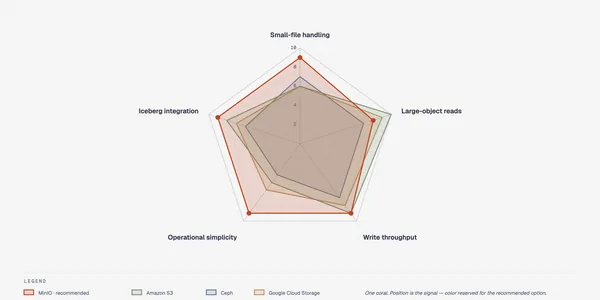</a><br><b>Radar / spider</b><br><sub>Multi-axis comparison</sub></td>
  <td align="center"><a href="docs/screenshots/loop.png">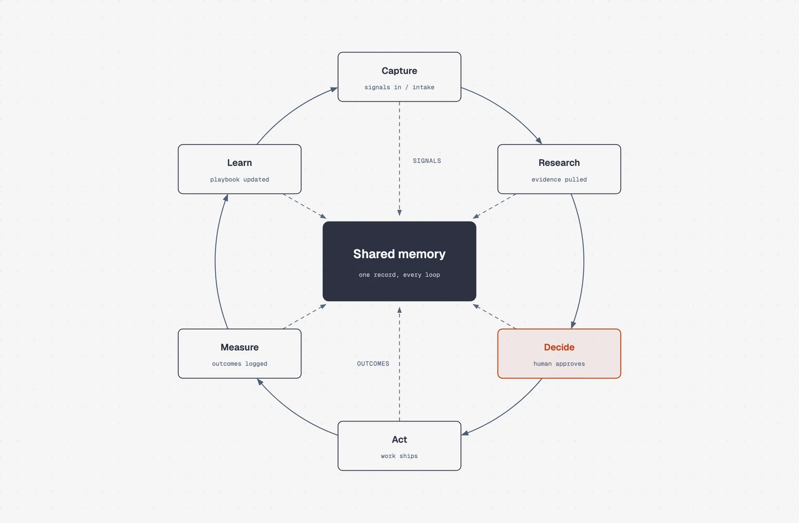</a><br><b>Loop / flywheel</b><br><sub>Reinforcing cycle + shared hub</sub></td>
  <td align="center"><a href="docs/screenshots/nested.png">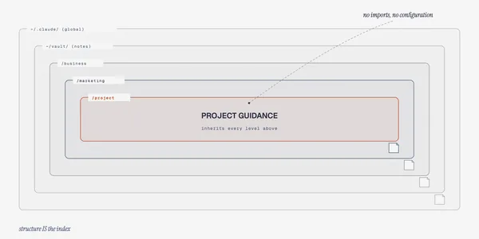</a><br><b>Nested</b><br><sub>Hierarchy by containment</sub></td>
</tr>
<tr>
  <td align="center"><a href="docs/screenshots/tree.png">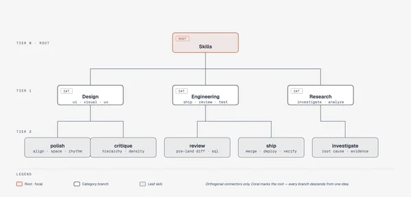</a><br><b>Tree</b><br><sub>Parent → children</sub></td>
  <td align="center"><a href="docs/screenshots/org-chart.png">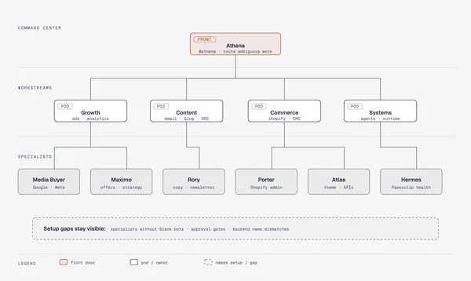</a><br><b>Org chart</b><br><sub>Ownership + routing</sub></td>
  <td align="center"><a href="docs/screenshots/layers.png">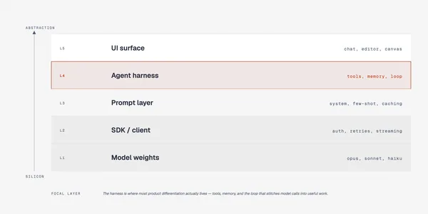</a><br><b>Layer stack</b><br><sub>Stacked abstractions</sub></td>
</tr>
<tr>
  <td align="center"><a href="docs/screenshots/venn.png">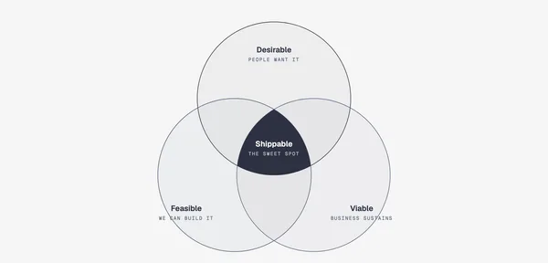</a><br><b>Venn</b><br><sub>Set overlap</sub></td>
  <td align="center"><a href="docs/screenshots/pyramid.png">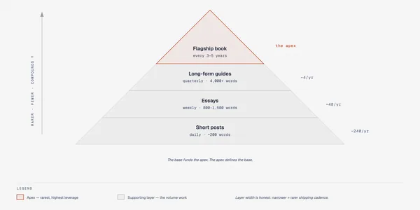</a><br><b>Pyramid / funnel</b><br><sub>Ranked hierarchy or drop-off</sub></td>
  <td align="center"><a href="docs/screenshots/bar.png">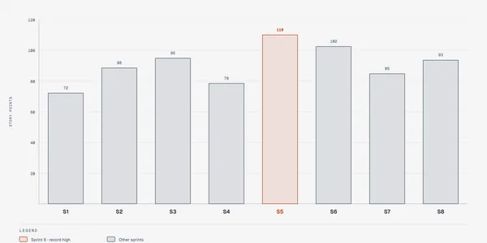</a><br><b>Bar chart</b><br><sub>Categorical comparison</sub></td>
</tr>
<tr>
  <td align="center"><a href="docs/screenshots/treemap.png">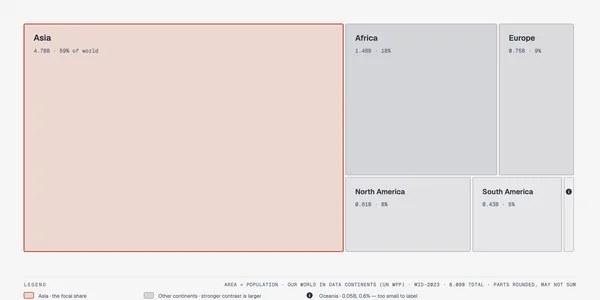</a><br><b>Treemap</b><br><sub>Part-of-whole by area</sub></td>
  <td align="center"><a href="docs/screenshots/line.png">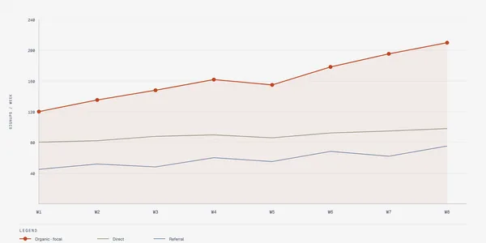</a><br><b>Line chart</b><br><sub>Trends over time</sub></td>
  <td align="center"><a href="docs/screenshots/gantt.png">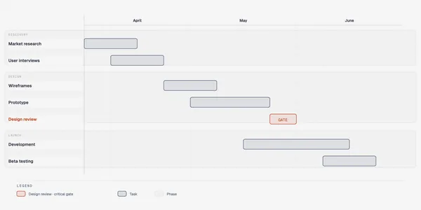</a><br><b>Gantt</b><br><sub>Tasks + phases on a timeline</sub></td>
</tr>
<tr>
  <td align="center"><a href="docs/screenshots/scatter.png">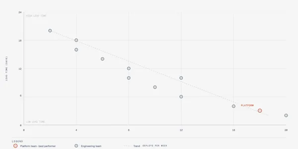</a><br><b>Scatter plot</b><br><sub>Distribution + correlation</sub></td>
  <td align="center"><a href="docs/screenshots/high-level.png">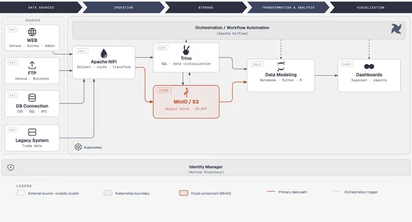</a><br><b>High-Level</b><br><sub>End-to-end stack on a cluster</sub></td>
  <td align="center"><a href="docs/screenshots/process.png">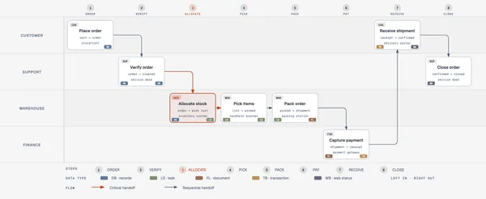</a><br><b>Process</b><br><sub>Multi-actor sequential workflow</sub></td>
</tr>
<tr>
  <td align="center"><a href="docs/screenshots/medallion.png">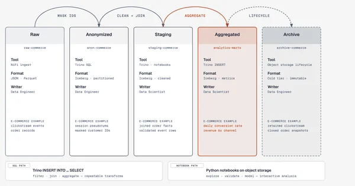</a><br><b>Medallion</b><br><sub>Multi-tier data storage</sub></td>
  <td align="center"><a href="docs/screenshots/data-flow.png">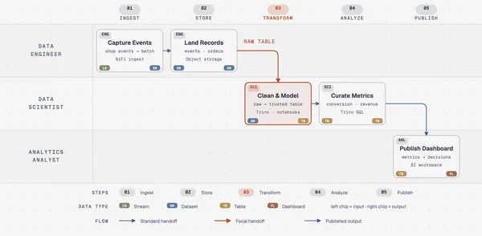</a><br><b>Data flow</b><br><sub>Role-scoped pipeline steps</sub></td>
  <td align="center"><a href="docs/screenshots/dp-integration.png">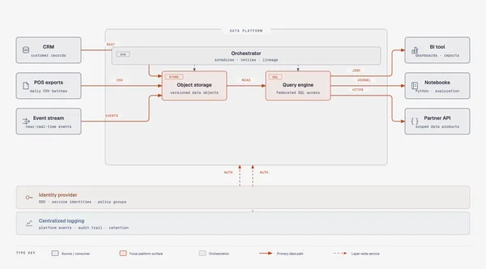</a><br><b>DP integration</b><br><sub>Sources → core → consumers</sub></td>
</tr>
<tr>
  <td align="center"><a href="docs/screenshots/dp-security-matrix.png">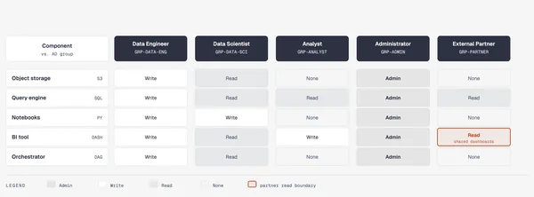</a><br><b>DP security matrix</b><br><sub>Per-role access permissions</sub></td>
  <td align="center"><a href="docs/screenshots/sankey.png">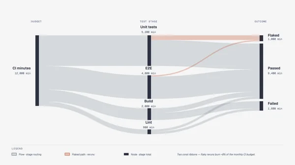</a><br><b>Sankey</b><br><sub>Quantities that split + merge</sub></td>
  <td align="center"><a href="docs/screenshots/fishbone.png">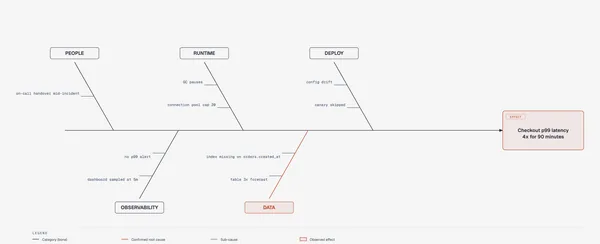</a><br><b>Fishbone</b><br><sub>Grouped causes → one effect</sub></td>
</tr>
<tr>
  <td align="center"><a href="docs/screenshots/wardley.png">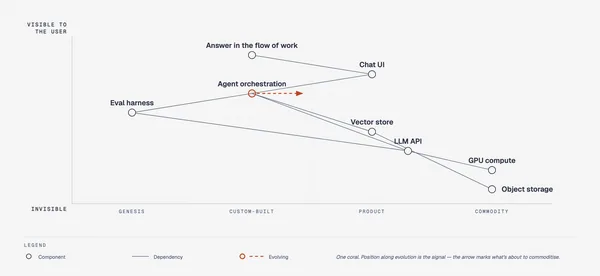</a><br><b>Wardley map</b><br><sub>Value chain × evolution</sub></td>
  <td align="center"><a href="docs/screenshots/kanban.png">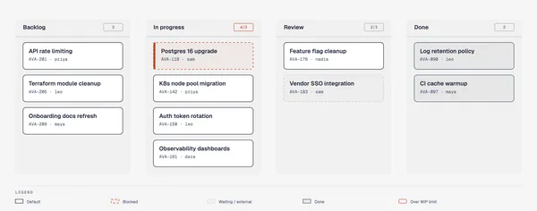</a><br><b>Kanban</b><br><sub>Work in progress by state</sub></td>
  <td align="center"><a href="docs/screenshots/journey.png">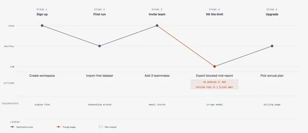</a><br><b>User journey</b><br><sub>Stages, actions + sentiment</sub></td>
</tr>
<tr>
  <td align="center"><a href="docs/screenshots/deployment.png">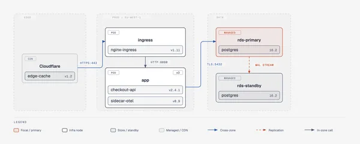</a><br><b>Deployment</b><br><sub>Zones, hosts + artifacts</sub></td>
  <td align="center"><a href="docs/screenshots/dependency.png">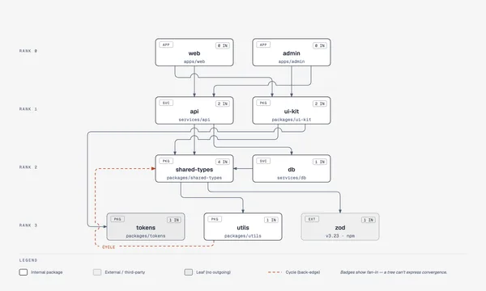</a><br><b>Dependency graph</b><br><sub>Fan-in, ranks + cycles</sub></td>
  <td align="center"><a href="docs/screenshots/uml-class.png">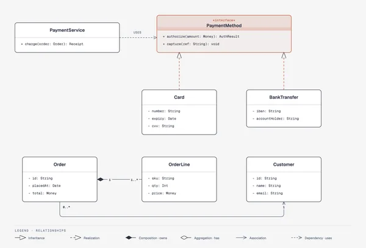</a><br><b>UML class</b><br><sub>Classes, operations + typed relations</sub></td>
</tr>
<tr>
  <td align="center"><a href="docs/screenshots/story-map.png">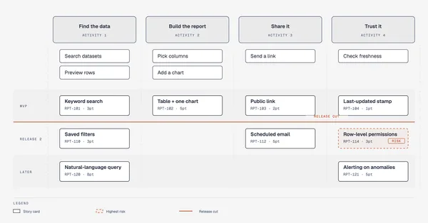</a><br><b>Story map</b><br><sub>Backbone × release slices</sub></td>
  <td align="center"><a href="docs/screenshots/db-schema.png">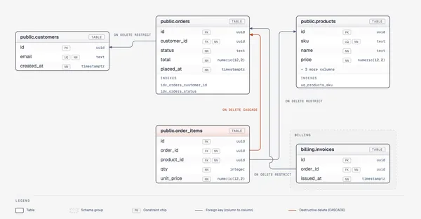</a><br><b>Database schema</b><br><sub>Physical tables + column FKs</sub></td>
  <td align="center"><a href="docs/screenshots/polar.png">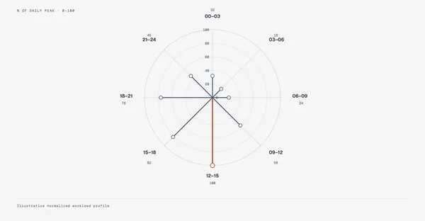</a><br><b>Polar chart</b><br><sub>Cyclic magnitude · linear radius</sub></td>
</tr>
<tr>
  <td align="center" width="33%"><a href="docs/screenshots/waterfall.png">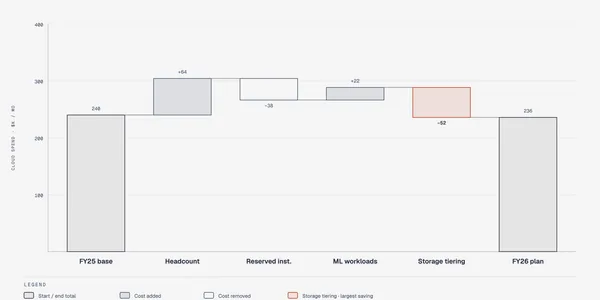</a><br><b>Waterfall</b><br><sub>Running total + signed bridges</sub></td>
  <td align="center" width="33%"><a href="docs/screenshots/architecture-delta.png">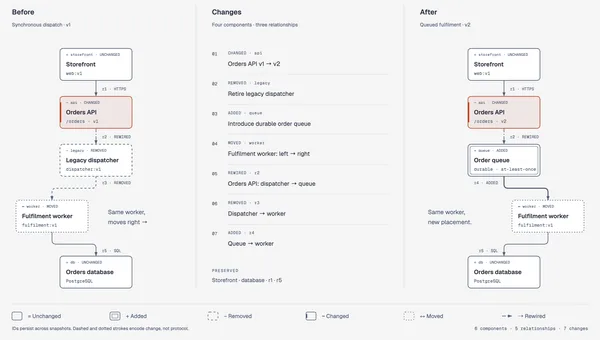</a><br><b>Architecture delta</b><br><sub>Before · Changes · After topology</sub></td>
  <td align="center" width="33%"><a href="docs/screenshots/exploded.png">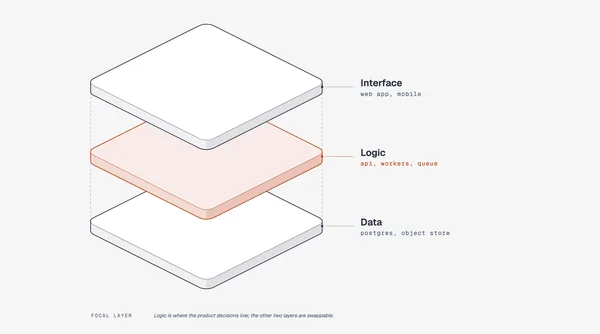</a><br><b>Exploded axonometric</b><br><sub>Parts pulled apart on one axis</sub></td>
</tr>
<tr>
  <td align="center" width="33%"><a href="docs/screenshots/axonometric-plan.png">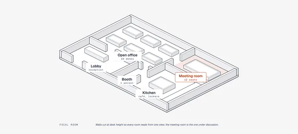</a><br><b>Axonometric plan</b><br><sub>Rooms and buildings on one plate</sub></td>
  <td align="center" width="33%"><a href="docs/screenshots/heatmap.png">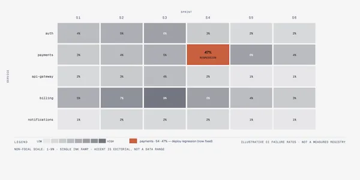</a><br><b>Heatmap</b><br><sub>Value per row × column cell</sub></td>
  <td align="center" width="33%"><a href="docs/screenshots/service-blueprint.png">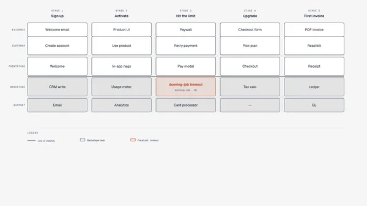</a><br><b>Service blueprint</b><br><sub>Frontstage and backstage on a shared stage grid</sub></td>
</tr>
</table>

Several types have named variants that share their reference: Line covers slopegraph, ridgeline, streamgraph and bump; Scatter covers bubble, beeswarm and box plot; Treemap covers marimekko.

Architecture can nest administrative bands and traffic boxes in one snapshot when the hierarchy itself is the claim: dashed rx=4 bands for billing and permissions, solid rx=8 boxes for networks, and managed services outside every subnet. See the [containment example](skills/diagram-design-local/assets/example-architecture-containment.html) and [type-architecture.md](skills/diagram-design-local/references/type-architecture.md).

Architecture delta compares synchronized topologies through a Before · Changes · After ledger of added, removed, changed, moved, and rewired objects. See its [reference](skills/diagram-design-local/references/type-architecture-delta.md) and [order-fulfilment example](skills/diagram-design-local/assets/example-architecture-delta.html). Attribute-only comparisons remain tables; a single snapshot uses Architecture.

Exploded axonometric draws one object in 2:1 dimetric projection with its parts lifted apart at equal gaps: a [phone teardown](skills/diagram-design-local/assets/example-exploded-phone.html), an [unboxing](skills/diagram-design-local/assets/example-exploded-unboxing.html), an [app stack](skills/diagram-design-local/assets/example-exploded.html), an [AI agent stack](skills/diagram-design-local/assets/example-exploded-ai-stack.html), or a [mechanical keyboard](skills/diagram-design-local/assets/example-exploded-keyboard.html). Every coordinate comes from one projection function. See its [reference](skills/diagram-design-local/references/type-exploded.md).

Axonometric plan uses the same projection for one floor or one site: walls cut at desk height so every room reads from a single view, or buildings on a campus tagged by build phase. See the [office floor](skills/diagram-design-local/assets/example-axonometric-plan.html), the [campus](skills/diagram-design-local/assets/example-axonometric-plan-campus.html), the [coffee shop](skills/diagram-design-local/assets/example-axonometric-plan-coffee-shop.html), the [fulfillment floor](skills/diagram-design-local/assets/example-axonometric-plan-warehouse.html), and the [reference](skills/diagram-design-local/references/type-axonometric-plan.md).

**Browse the gallery:** open [`skills/diagram-design-local/assets/index.html`](skills/diagram-design-local/assets/index.html) locally to follow ordinary links to each light, dark, or full-editorial example. To publish it, enable GitHub Pages with **GitHub Actions** as the source in this repository's settings, then run the existing **Deploy gallery to GitHub Pages** workflow. Its target is [andrewgodlewsky.github.io/Diagram-design2](https://andrewgodlewsky.github.io/Diagram-design2/). Each type has one number, 01 to 45; its variants and worked examples carry the same number with a letter. The catalog is static HTML with no JavaScript, frames, or automatic resource loads.

---

## Onboarding: make it look like *your* brand

Use the default jet-black and tangerine palette, or supply a local CSS file, a design-token folder, a style guide, or pasted values. The agent reads only the paths you supply, maps literal values to semantic color and typography roles, and records their provenance. It does not visit websites, run scripts from your files, or follow font URLs.

For example: `Use ./design/tokens.css to style this diagram, then save the profile as acme.` The effective guide stays in the session or a user-selected project file. The installed package remains unchanged.

Text tokens target 4.5:1 contrast and essential marks 3:1 on the actual background. If a supplied token fails, the agent proposes an accessible adjustment and explains it. SVG templates include `role="img"`, resolving `aria-labelledby`, and first-child title/description elements with per-diagram IDs.

Fonts always resolve locally. Optional installed Instrument Serif, Geist, and Geist Mono lead generic serif, sans, and monospace fallbacks. No font files are bundled or downloaded. Font metrics differ across computers; structural checks do not establish pixel-identical rendering. See [Font source](skills/diagram-design-local/references/style-guide.md#font-source).

For multiple clients, save named profiles outside the package at `~/.diagram-design-local/profiles/<slug>.md`. An optional project `.diagram-design-local` marker containing `profile: <slug>` selects one directly. `default` always selects the shipped guide. Use `/diagram-design-local:profile`, `/diagram-design-local-profile`, or natural language to manage profiles. See [onboarding.md](skills/diagram-design-local/references/onboarding.md) and [profiles.md](skills/diagram-design-local/references/profiles.md).

---

## Quickstart

Browse the [local gallery](skills/diagram-design-local/assets/index.html) for examples, or start directly from a request. Viewing is optional; authoring and validation do not launch a browser.

Then ask your agent for a diagram, like the prompts at the top of this page. A sequence with token refresh uses the ALT combined-fragment grammar in `type-sequence.md`; see [`example-sequence-oauth.html`](skills/diagram-design-local/assets/example-sequence-oauth.html).

Operator recipes for editable installs, first diagrams, brand setup, import, export, validation, Windows junctions, and reusable prompts live in [`docs/cookbook.md`](docs/cookbook.md).

You can also start from a template directly:

```bash
cp skills/diagram-design-local/assets/template.html my-diagram.html        # minimal light
cp skills/diagram-design-local/assets/template-full.html my-diagram.html   # editorial with summary cards
```

### Semantic patterns

[Semantic patterns](skills/diagram-design-local/references/semantic-patterns.md) explain behavior such as queue bottlenecks, policy decisions, lifecycle phases, and traceable block decomposition. Select a pattern when behavior carries the meaning, then a visual type for its layout. Every state and outcome is visible in a single static composition.

---

## Import from draw.io, Mermaid, or Excalidraw

Already have diagrams in draw.io / diagrams.net, Mermaid, or Excalidraw? Point the skill at the source and it **redraws** them: same content, this design system, at whatever size the destination needs.

[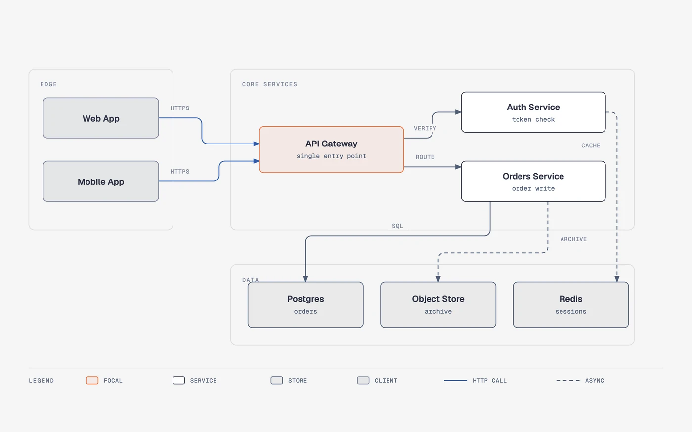](docs/screenshots/import-drawio.png)

*A 12-node draw.io file redrawn at `balanced` detail for a blog post. The source's six pastel fills became one accent; its hand-dragged coordinates became a 4px grid.*

```
/diagram-design-local:import-drawio platform.drawio
/diagram-design-local:import-drawio platform.drawio --size=slide-16x9 --detail=simplified --audience=executive
/diagram-design-local:import-drawio platform.drawio --detail=faithful --format=svg --page=all
/diagram-design-local:import-mermaid README.md --diagram=all
/diagram-design-local:import-mermaid architecture.mmd --size=slide-16x9 --detail=simplified
/diagram-design-local:import-excalidraw whiteboard.excalidraw --size=slide-16x9 --detail=simplified
```

Or just ask: *"redraw this drawio file for my deck"*, *"make this Mermaid block editorial"*, *"make this whiteboard sketch presentable"*, or *"この Mermaid をスライド用にきれいにして"*.

Reads the common containers draw.io writes (`.drawio`, `.drawio.xml`, `.drawio.png` with an embedded diagram, and `.drawio.svg`), including compressed payloads that look like base64 garbage in an editor.
For Mermaid, it accepts `.mmd`, `.mermaid`, and one or more fenced `mermaid` blocks in Markdown. UTF-8 files may include a byte-order mark.
For Excalidraw, it accepts `.excalidraw` and `.excalidraw.json` scene files (not `.excalidraw.png`/`.excalidraw.svg` exports). It parses text only: no rendering, JavaScript, browser, network, or followed click targets.

### The four dials

The point isn't conversion, it's **fitting the output to where it's going**. Same source file, three different diagrams:

| Dial | Options | What it changes |
|---|---|---|
| **Format** | `html` · `svg` | The deliverable: SVG for vector hand-off, HTML for the complete page. |
| **Size** | `doc-inline` · `doc-wide` · `slide-16x9` · `slide-4x3` · `social-og` · `social-square` · `print-a4-landscape` · `print-a3-landscape` · `print-letter-landscape` · `fit` | The `viewBox` **and the type ramp**: a projected slide gets 16px node names, not 12px. |
| **Detail** | `faithful` (≤24 nodes, zoned) · `balanced` (≤12) · `simplified` (≤7) | How much of the source survives, via a fixed degrade ladder: decorations, then duplicates, then leaf clusters, then infrastructure. |
| **Audience** | `engineer` · `mixed` · `executive` | The *wording*, not the count. `Auth Service / JWT · RS256 · :8443` → `Auth Service / token check` → `Sign-in`. |

Every import ends with a **fidelity ledger** listing what got merged, collapsed, or dropped. You know the source; you'd notice anyway.

```
Detail: balanced · 12 source nodes → 8 drawn
Collapsed: "Token valid?" decision → edge label on Gateway → Auth
Dropped:   1 sticky note ("legacy path, to be retired"), unconnected in source
Kept in full: the request path (Web/Mobile → Gateway → Orders → Postgres)
```

What never carries over: source or renderer coordinates, source palette, source fonts, draw.io's diagonal connector spaghetti, Mermaid's automatic layout, or Excalidraw's hand-drawn geometry. What always does: components, relationships, grouping, and direction. See [`references/import-drawio.md`](skills/diagram-design-local/references/import-drawio.md), [`references/import-mermaid.md`](skills/diagram-design-local/references/import-mermaid.md), [`references/import-excalidraw.md`](skills/diagram-design-local/references/import-excalidraw.md), and [`references/output-spec.md`](skills/diagram-design-local/references/output-spec.md).

---

## Export to SVG

Ask `Export this diagram as SVG`, or run `/diagram-design-local:export-diagram path/to/diagram.html` in Claude Code and `/diagram-design-local-export-diagram path/to/diagram.html` in Pi. The standalone SVG retains diagram CSS and namespaces local definitions. Editorial headers and cards remain in the HTML source.

The packaged helper uses Python's standard library:

```text
python skills/diagram-design-local/scripts/self_check.py path/to/diagram.html
python skills/diagram-design-local/scripts/export_svg.py path/to/diagram.html
```

All exports use installed fonts and generic fallbacks. Unsafe or active content is refused before successful output. PNG rendering, animation, remote resources, and browser launch are outside this skill's scope. See [export.md](skills/diagram-design-local/references/export.md).

For [traceable block decomposition](skills/diagram-design-local/references/semantic-patterns.md), `--registry` emits only the `.registry.json` metadata sidecar. Combine it with `--svg-only` for both. See [export-registry.md](skills/diagram-design-local/references/export-registry.md).

---

## Architecture

Progressive disclosure. `SKILL.md` routes behavior first when needed, then layout. Semantic and type references load only when relevant.

```
Diagram-design2/
├── .agents/plugins/marketplace.json  # Codex marketplace catalog
├── .claude-plugin/                   # Claude marketplace + plugin manifest
├── .codex-plugin/                    # Codex plugin manifest
├── .factory-plugin/                  # Factory Droid marketplace + plugin manifest
├── .qoder-plugin/                    # Qoder native plugin manifest
├── commands/
│   ├── export-diagram.md             # plugin export command
│   ├── import-drawio.md              # plugin draw.io import command
│   ├── import-mermaid.md             # plugin Mermaid import command
│   ├── import-excalidraw.md          # plugin Excalidraw import command
│   ├── profile.md                    # plugin client-profile command
│   └── doctor.md                     # plugin environment diagnostics command
├── prompts/
│   ├── diagram-design-local-export-diagram.md             # Pi `/diagram-design-local-export-diagram` prompt template
│   ├── diagram-design-local-import-mermaid.md             # Pi Mermaid import prompt template
│   ├── diagram-design-local-import-excalidraw.md          # Pi Excalidraw import prompt template
│   ├── diagram-design-local-profile.md                    # Pi `/diagram-design-local-profile` prompt template
│   └── diagram-design-local-doctor.md                     # Pi `/diagram-design-local-doctor` diagnostics prompt template
├── skills/
│   └── diagram-design-local/
│       ├── SKILL.md                  # philosophy, selection guide, checklist
│       ├── references/               # loaded only when a type or primitive is chosen
│       │   ├── style-guide.md        # single source of truth for colors + fonts
│       │   ├── semantic-patterns.md  # behavior patterns independent of layout
│       │   ├── onboarding.md         # local files and pasted brand tokens
│       │   ├── profiles.md           # named client profiles + project markers
│       │   ├── doctor.md             # environment diagnostics
│       │   ├── import-drawio.md      # draw.io redraw procedure
│       │   ├── import-mermaid.md     # Mermaid redraw procedure
│       │   ├── import-excalidraw.md  # Excalidraw redraw procedure
│       │   ├── output-spec.md        # format × size × detail level
│       │   ├── export.md             # local SVG export + sizing
│       │   ├── export-registry.md    # block-metadata JSON sidecar export
│       │   ├── primitives-core.md    # exact markup for nodes, arrows, labels
│       │   ├── layout-budget.md      # 4px grid + per-type budgets
│       │   ├── primitive-annotation.md
│       │   ├── primitive-icons.md
│       │   ├── primitive-sketchy.md
│       │   ├── primitive-terminal.md
│       │   ├── type-architecture.md
│       │   ├── type-architecture-delta.md
│       │   ├── type-axonometric-plan.md
│       │   ├── type-bar.md
│       │   ├── type-data-flow.md
│       │   ├── type-db-schema.md
│       │   ├── type-dependency.md
│       │   ├── type-deployment.md
│       │   ├── type-dp-integration.md
│       │   ├── type-dp-security-matrix.md
│       │   ├── type-er.md
│       │   ├── type-exploded.md
│       │   ├── type-fishbone.md
│       │   ├── type-flowchart.md
│       │   ├── type-gantt.md
│       │   ├── type-heatmap.md
│       │   ├── type-high-level.md
│       │   ├── type-it-state.md
│       │   ├── type-journey.md
│       │   ├── type-kanban.md
│       │   ├── type-layers.md
│       │   ├── type-line.md
│       │   ├── type-loop.md
│       │   ├── type-medallion.md
│       │   ├── type-nested.md
│       │   ├── type-org-chart.md
│       │   ├── type-polar.md
│       │   ├── type-process.md
│       │   ├── type-pyramid.md
│       │   ├── type-quadrant.md
│       │   ├── type-radar.md
│       │   ├── type-sankey.md
│       │   ├── type-scatter.md
│       │   ├── type-sequence.md
│       │   ├── type-service-blueprint.md
│       │   ├── type-state.md
│       │   ├── type-story-map.md
│       │   ├── type-swimlane.md
│       │   ├── type-timeline.md
│       │   ├── type-tree.md
│       │   ├── type-treemap.md
│       │   ├── type-uml-class.md
│       │   ├── type-venn.md
│       │   ├── type-wardley.md
│       │   └── type-waterfall.md
│       ├── scripts/
│       │   ├── drawio_extract.py     # draw.io → structured IR
│       │   ├── mermaid_extract.py    # Mermaid → structured IR
│       │   ├── excalidraw_extract.py  # Excalidraw → structured IR
│       │   ├── export_svg.py         # standalone SVG export
│       │   ├── static_safety.py      # shared local/static content validation
│       │   └── self_check.py         # packaged output self-check (runs installed)
│       └── assets/
│           ├── index.html            # static gallery with ordinary links
│           ├── icons.html            # icon library browser
│           ├── template*.html        # scaffolds for new diagrams
│           ├── example-<type>.html   # 3 variants per type
│           ├── example-loop-terminal.html
│           ├── example-quadrant-consultant.html
│           ├── example-import-drawio.html
│           ├── example-import-mermaid.html
│           ├── example-import-excalidraw.html
│           └── example-sequence-oauth*.html
├── scripts/                          # CI gates and build helpers (see CONTRIBUTING.md)
│   ├── lint-skin.py                  # palette, fonts, a11y, single-file safety
│   ├── verify-docs-sync.py           # routing, gallery, README and count sync
│   ├── verify-geometry.py            # label, connector and port geometry
│   └── fixtures/                     # draw.io, Mermaid and Excalidraw test inputs
├── docs/cookbook.md                  # operator recipes for editable installs and common tasks
├── docs/adr/                         # short records of settled design decisions
├── docs/superpowers/                 # design specs and implementation plans (plans/, specs/)
├── docs/hero/                        # README demo GIFs (dark, light) and social preview image
├── docs/screenshots/                 # existing full-resolution gallery previews
├── docs/screenshots/thumbs/          # generated WebP previews the README renders
├── CHANGELOG.md                      # release history
└── CONTRIBUTING.md                   # validation gates and how each one works
```

This keeps the agent's working context tight: routine diagrams load one type reference; behavior-rich diagrams add the routed semantic reference.

### What loads when

At startup, the agent sees only the skill name and description. When a request matches, it loads `SKILL.md`; semantic and type references are pulled in only when relevant.

| You ask for… | Agent loads |
|---|---|
| "Make me a flowchart" | `SKILL.md` + `references/type-flowchart.md` |
| "Build an architecture diagram" | `SKILL.md` + `references/type-architecture.md` |
| "Show nested admin vs traffic scopes" | `SKILL.md` + `references/type-architecture.md` |
| "Show what was added, removed, changed, moved, or rewired in this migration" | `SKILL.md` + `references/type-architecture-delta.md` |
| "Show what's inside this device, exploded" | `SKILL.md` + `references/type-exploded.md` |
| "Draw our office floor plan" | `SKILL.md` + `references/type-axonometric-plan.md` |
| "Compare why these two policy requests differ" | `SKILL.md` + `references/semantic-patterns.md` + `references/type-flowchart.md` |
| "Use the tokens in my local style guide" | `SKILL.md` + `references/onboarding.md` + `references/style-guide.md` |
| "Use my saved Acme client profile" | `SKILL.md` + `references/profiles.md` + `~/.diagram-design-local/profiles/acme.md` |
| "Add an editorial callout to this diagram" | `SKILL.md` + `references/primitive-annotation.md` |
| "Give me a hand-drawn version" | `SKILL.md` + `references/primitive-sketchy.md` |
| "Give me a terminal / CLI-window version" | `SKILL.md` + `references/primitive-terminal.md` |
| "Redraw this .drawio file for my deck" | `SKILL.md` + `references/import-drawio.md` + `references/output-spec.md` + the chosen type's reference |
| "Redraw this Mermaid block for my deck" | `SKILL.md` + `references/import-mermaid.md` + `references/output-spec.md` + the chosen type's reference |
| "Redraw this Excalidraw sketch for my deck" | `SKILL.md` + `references/import-excalidraw.md` + `references/output-spec.md` + the chosen type's reference |
| Routine static diagram-making (any visual type) | `SKILL.md` + that one type's reference, plus `references/primitives-core.md` or `references/layout-budget.md` only when it needs exact markup or a per-type budget row |

No matter how many types exist, the agent only reads the one you need. Add a new type tomorrow and nothing else changes.

---

## It's working if…

- A routine request ("make me a flowchart") loads `SKILL.md`, exactly one type reference, and at most the two core references (`primitives-core.md`, `layout-budget.md`), and nothing else.
- Before drawing, the agent states the chosen type, pattern, size, and planned cuts, then writes the static HTML/SVG.
- The output is one `.html` file that opens double-clicked, offline, with no network requests.
- Screen readers announce the diagram's title and description; all meaning is present in one static frame.
- `python3 skills/diagram-design-local/scripts/self_check.py <file>` prints `OK` on the generated file.
- After brand onboarding, new diagrams use the supplied local paper, ink, accent, and font stacks, with their sources recorded.

If any of these fail, that's a bug worth filing.

## The design system (in one paragraph)

One accent color, 1 or 2 focal elements per diagram. Three optional installed font families: Instrument Serif (title + italic callouts), Geist sans (node names), Geist Mono (technical sublabels), each with a generic fallback. 1px hairline borders, no shadows, max border-radius 10px. Every coordinate, width, and gap is divisible by 4. That rule is non-negotiable; it's what keeps the diagrams from feeling AI-generated. Mono is for technical content (ports, URLs, field types), not a blanket "dev" aesthetic. Accent-tinted focal nodes draw the eye to the 1 or 2 things that matter. Full spec in [`SKILL.md`](skills/diagram-design-local/SKILL.md#5-design-system).

---

## Primitives

- **Annotation callout**: italic Instrument Serif + dashed Bézier leader, for editorial asides that sit in the margins. See [`skills/diagram-design-local/references/primitive-annotation.md`](skills/diagram-design-local/references/primitive-annotation.md).
- **Sketchy filter**: SVG turbulence + displacement map for a hand-drawn variant. Good for essays, not for technical docs. See [`skills/diagram-design-local/references/primitive-sketchy.md`](skills/diagram-design-local/references/primitive-sketchy.md).
- **Icon set**: 87 monochrome IT/cloud icons (laptop, phone, user, server, database, Docker, Kubernetes, AWS, Azure, GitHub, Postgres…) for richer architecture and sequence diagrams. Stroked icons from [Tabler Icons](https://tabler.io/icons) (MIT); brand silhouettes from [Simple Icons](https://simpleicons.org) (CC0). Each icon uses `currentColor` so it inherits the editorial skin or your onboarded brand. See [`skills/diagram-design-local/references/primitive-icons.md`](skills/diagram-design-local/references/primitive-icons.md); browse the [gallery](skills/diagram-design-local/assets/icons.html). Regenerate with `python scripts/build-icons.py`.

---

## When *not* to use this skill

- **Diagrams that live in Git and change every sprint** → Mermaid. It diffs, and GitHub renders it.
- **Quick unicode diagrams** for tweets or terminal output → wiretext-style skill.
- **Lists of anything** → a table or bullets.
- **Attribute-only before/after comparisons** → a table; topology changes can use Architecture delta.
- **One-shape "diagrams"** (a single box with a label) → just write the sentence.

Before drawing, ask: *would a reader learn more from this than from a well-written paragraph?* If no, don't draw.

---

## Contributing

Contributions are welcome: new diagram types, import grammar support, examples, docs, and tooling. [CONTRIBUTING.md](CONTRIBUTING.md) covers the validation gates (static safety, skin lint, geometry and data-encoding verifiers, docs sync), how each one works, and the CI setup. Every pull request runs them on Linux, Windows, and macOS. See [CODE_OF_CONDUCT.md](CODE_OF_CONDUCT.md) for community standards and [CHANGELOG.md](CHANGELOG.md) for release history.

---

## About

Maintained here by [AndrewGodlewsky](https://github.com/AndrewGodlewsky). Originally created by **Cathryn Lavery** at [LittleMight](https://littlemight.com). The original MIT copyright and license are preserved in [LICENSE](LICENSE).
